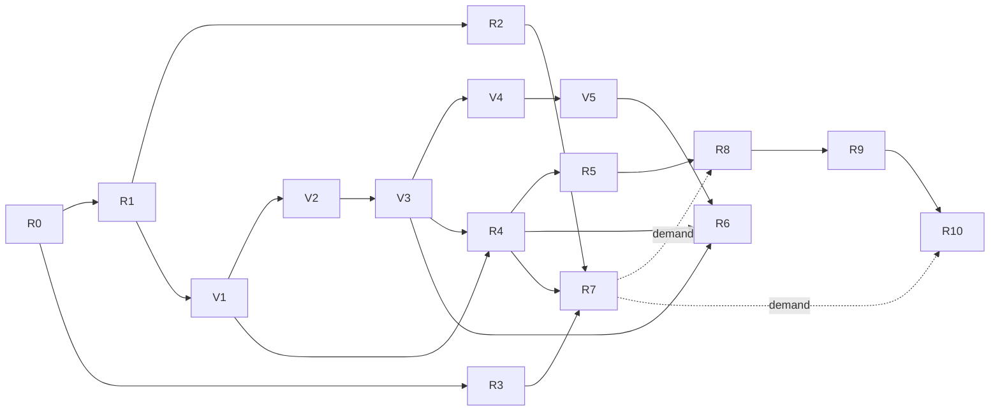

# Reactor application roadmap

Reactor turns a drawing into a working, data-backed web prototype, from one typed document
that people and AI edit through the same validated operations.

The first user is a designer who builds app prototypes for others to try: clients, teammates
or test users. Starting from a drawing, a screenshot or a sentence, they need screens that
navigate, controls that take input and sample data. Others open the result from a link, and the
designer keeps changing it as a design. Each milestone below says what this user can do after
it.

Planning date: 2026-10-14; variable foundation updated 2026-10-17; screen/view and responsive
model updated 2026-10-23. Work is planned unless
its implementation status explicitly says otherwise.
[REFACTOR_PLAN.md](REFACTOR_PLAN.md) keeps the earlier audit, its dated findings and its phases.

## Current state

| Capability                 | State                                                                                                                                                                                                                                                                                                                                                                                                                                                                                                                                                                                                                                                                                                              |
| -------------------------- | ------------------------------------------------------------------------------------------------------------------------------------------------------------------------------------------------------------------------------------------------------------------------------------------------------------------------------------------------------------------------------------------------------------------------------------------------------------------------------------------------------------------------------------------------------------------------------------------------------------------------------------------------------------------------------------------------------------------ |
| Drawing and editing        | Implemented and browser-tested: shapes, groups, layers, guides, snapping, inspector.                                                                                                                                                                                                                                                                                                                                                                                                                                                                                                                                                                                                                               |
| Components                 | Implemented: instances, overrides, nested sources, and copies from other documents updated on request ([componentLibrary.ts](src/app/componentLibrary.ts)).                                                                                                                                                                                                                                                                                                                                                                                                                                                                                                                                                        |
| Variables and templates | Implemented: central resolver, explicit bindings, typed aliases, opt-in user-defined dimensions with inherited color modes per Screen view, native design-system packages and a bounded DTCG adapter. Local simulation stays separate from authored frame/view/instance overrides. Contextual numeric/text measurement and responsive variants remain planned (V1–V5 and R4 below). |
| Saving and collaboration   | Implemented: IndexedDB, tab sync, Yjs merges, server sync when signed in.                                                                                                                                                                                                                                                                                                                                                                                                                                                                                                                                                                                                                                          |
| Images                     | Implemented: content-addressed, shared with the server when signed in ([assetSync.ts](src/app/services/assetSync.ts)).                                                                                                                                                                                                                                                                                                                                                                                                                                                                                                                                                                                             |
| Accounts                   | Implemented: workspaces, document roles and workspace invitations with sharing/acceptance UI and a read-only viewer preview. Presence is off ([serverSync.ts](src/app/services/serverSync.ts) passes no awareness).                                                                                                                                                                                                                                                                                                                                                                                                                                                                                                                                        |
| Undo and redo              | Implemented: each person undoes and redoes their own changes to a document's records, also while others edit ([collaboration.ts](src/app/services/collaboration.ts)).                                                                                                                                                                                                                                                                                                                                                                                                                                                                                                                                              |
| Operations                 | Implemented: paste goes through `applyOperations`, applied whole as one undo step that records its author ([#177](https://github.com/jtasek/reactor/pull/177)).                                                                                                                                                                                                                                                                                                                                                                                                                                                                                                                                                    |
| AI                         | Gateway implemented: `/api/ai` streams operations from Claude Haiku 5.5 or any OpenAI-compatible provider, checked and repaired once, with daily limits, and recorded eval cases replayed in CI ([#178](https://github.com/jtasek/reactor/pull/178)). Edit with words has a movable, dockable chat with local conversation history; it proposes added, changed and deleted shapes, variables and groups, applied as one undo step once accepted ([#179](https://github.com/jtasek/reactor/pull/179)). Requests use the selection with its group, variable and component dependencies, or the document when nothing is selected, bounded to 32 KiB of UTF-8 JSON and 300 records ([context.ts](src/ai/context.ts)). |
| Screens, data and behavior | Implemented: frame membership, inherited Hide/Lock, fixed stacks, initial hug/fill sizing, explicit component roles and navigation targets. Screens have stable logical identity and shared artwork; equal Screen views place them on Canvas with independent names, viewports and inherited color modes. Drawing, transforms, overlays, contextual alignment, and focused component editing through rotated/stack-positioned instances are implemented. Any or every view can be deleted and placed again from the Screens list. Responsive variants and a Flow feature remain planned. Data/list repetition is still absent. |
| Export and runtime | Implemented: explicitly invoked, sandboxed Preview with navigation, native inputs and image artwork. Runtime state is separate from document state. Read-only links, SVG export and a standalone web package remain planned. |

The editor surface depends on SVG: input converts through `getScreenCTM`
([helpers.ts](src/events/drivers/helpers.ts)) and shapes are measured with `getBBox`. That
stays; nothing below replaces the editor surface.

## Rules for every milestone

- Existing documents open, edit, save, copy and sync. Signed-out drawing works without a server.
- Schema changes preserve documents supported by the current reader: bump the version and
  provide a tested conversion when records or references change. In particular, introducing
  screens/views must preserve frame artwork and existing navigation targets. Pre-beta internal
  contracts may evolve; from R7, published apps' public contracts, API names and package format
  also stay compatible. Server tables always change through new migrations in
  `server/migrations.ts`; released ones are never edited.
- A new kind of durable record joins the readers, factories, copy and paste, collaboration and
  the merge repair in the same change: references to missing records are dropped, as deleting
  them would. A two-copy test covers a concurrent delete and reference.
- Actions stay synchronous and async work stays in services. Gestures commit synchronously.
- A new feature loads with its page or control. The entry bundle budget stays at 492 KiB, and
  248 KiB per file.
- A failed import, build or generation leaves working content and the last valid preview, and
  a result that arrives after a newer edit is dropped. Diagnostics name the record that caused
  them, and drafts are never deleted to make a build pass.
- Each step names its acceptance spec, a Vitest or Playwright file, and adds it in the same
  change. Generated output gets a byte snapshot per fixture, so regenerating is deterministic.
- CI runs lint, type checks, unit and server tests on PGlite, Chromium browser tests and the
  bundle budget, and recorded AI evals once AI lands. A nightly run, added with the first AI
  feature, runs live AI evals, a PostgreSQL container and other browsers. Physical devices are
  checked by hand, and the result records which ones.
- Imports are untrusted: packages, pasted data and screenshots. They have size, count and
  nesting limits, images are checked by their content as the server does, and text stays text.
- An adapter contract appears when its second implementation ships; until then, plain modules.
  First-party code comes before any third-party plugin.

## Architecture

### Document and identity

One document holds one application. Typed tables stay authoritative: shapes, components,
variables and the new records below. A pure graph reader exposes the relations between them;
there is no universal node and edge store. The generated application has its own contract,
apart from the store's `Application` type. IDs are stable and scoped to their document.
Copying records into another document remaps everything they depend on, and a name is a label
that never changes a reference.

A slice is what one view needs: a screen, or the selection, with every record it depends on
(components, variables, images and entities), read through the graph reader. The application
projection is the validated slice of an app's screens as plain data: frames, controls, layout,
data bindings and actions, with no store objects.

### Operations and undo

Undo works on the shared Yjs documents and tracks only this copy's own changes, so it covers
every existing action without rewriting it, and undoes a person's change even while others
edit. A gesture, a held key and an accepted AI proposal are one step each. R1 starts with a
spike that proves this with two copies.

Changes that arrive as data (AI proposals, imports, pastes) are typed operations applied by
`applyOperations`, one synchronous root action:

- every record it would write is checked with the durable readers;
- a reference must name an existing ID, or a temporary key made earlier in the same batch;
- it applies all or nothing, as one undo step;
- it records who made the batch: a person, or an AI request with its model.

### Screens, canvas views and responsive components

The canvas is a design workspace that may show many screens, and many views of the same screen,
at once. It never executes navigation or input behavior. Ordinary frames and loose artwork may
coexist with screen views. Flow and Prototype are separate features that the person invokes;
neither is a mode silently entered by clicking a drawn control.

There is one shared, pannable and zoomable design canvas, not one editor canvas per screen.
Home, Checkout, Settings and ordinary layout frames can all be visible and editable side by
side. A second size or mode view of Home is optional. "Screen view" means a placed frame-like
representation on this same canvas, not a separate page, tab or running prototype.

For example, one canvas may contain Home (phone, Dark), Home (desktop, Light), Checkout
(phone, Dark), Settings (tablet), a free-standing component study frame and loose artwork.
Selecting any of these does not hide the others or navigate the application. Create screen
places an editable screen on the canvas directly; managing a separate definition first is
not a prerequisite in the user interface.

| Concept | Authored responsibility | Local presentation/runtime state |
| --- | --- | --- |
| Screen definition | Stable destination ID, name, default layout and optional responsive layouts; owns content and component instances through existing frame trees. | Selection of its currently resolved layout. |
| Screen view | Stable view ID, reference to one screen, canvas position, viewport dimensions and optional mode overrides for comparison. | Selection, hover, measurement caches and temporary inspection settings. |
| Component | Shapes and nested instances, variable bindings, stable exposed property IDs, optional role and variant family. | Resolved appearance within the current instance path and context. |
| Interaction | Trigger and typed action on a screen/control; navigation references a screen ID. | Executed only inside an invoked prototype session. |
| Flow view | Optional saved diagram positions for screen nodes; edges come from the same interaction records. | Diagram selection and diagnostics; opening it executes nothing. |
| Prototype session | Launch configuration may name a start screen, size and modes. | Current screen, navigation history, input values and mode/viewport changes; never document edits. |

Names are labels, not identity. A screen is explicitly defined, not permanently inferred from
being a top-level frame. Initial conversion keeps the current runtime's top-level-frame screens
working; new ordinary frames do not silently become navigation destinations.

A screen view references a definition rather than copying its shapes. Editing content through
one view edits the definition and updates every view; moving/resizing the view or changing its
mode overrides edits only that view's configuration. Creating another view and duplicating a
screen definition are separate commands. Deleting a view leaves its screen and navigation
intact; deleting a screen identifies affected views/actions and supports undo. Unresolved
concurrent references remain diagnosable without silently redirecting to another screen.

Each projected object is addressed by view ID, instance path and source object ID. Rendering,
selection, hit testing, text measurement and gestures use that same address and transform.
Canvas placement is separate from layout coordinates inside the screen. A repeated view can
therefore resolve different geometry without creating duplicate authored shapes or IDs.
Explorer nests the resolved contents under each screen view, identifies the shared screen and
its size/context, and preserves a way to edit the source definition. Global layers remain an
independent organization mechanism; they do not determine screens or navigation.

Frames retain Free/Row/Column layout, gap, padding, alignment and fixed/hug/fill sizing with
min/max constraints. Responsive layout first uses those rules. A screen may later explicitly
provide alternate layout trees for cases continuous reflow cannot express; all layouts retain
one screen destination, and reusable components/compatible property IDs carry shared content.
Creating an alternate layout is an explicit authoring operation, not a copy on every resize.

Component variants share a stable public property/role contract; variant artwork may differ.
An instance uses the default variant, an explicit variant, or Auto. Auto initially uses ordered,
unique minimum-width thresholds plus a base variant. Its author selects screen width or the
available inner width of its layout parent; these are distinct contexts, never guessed device
names. The greatest matching threshold wins, with exact boundary behavior defined in tests.
Different instances of one component may resolve different variants simultaneously. Content,
variable bindings, compatible overrides and interactions survive variant switches.

Variant choice and layout form one bounded resolution process. A rule must not oscillate because
its chosen variant changes the hug width that selects that variant. Diagnose such dependencies
and use a deterministic authored fallback variant/size; never write the computed choice or
geometry to shared state. Inspector explains the active mode, variant, width source and rule.

### Invoked Flow and Prototype features

Roles (Text, Input, Button, List, Image) describe semantics and typed property links. Actions
such as Navigate describe behavior separately. A Button role alone does not cause navigation;
its interaction chooses the destination. Keep the drawing's component tree as the control tree.
Actions address logical controls/property IDs, not transient canvas-view or variant artwork IDs.

Flow opens on explicit request and visualizes screen definitions and their authored actions.
Several canvas views of Home produce one Home flow node. Choosing a control and target in Flow
edits the same interaction as Inspector. Moving a flow node changes only diagram placement.
Canvas coordinates never define navigation order. R9 later extends these actions with conditions
and asynchronous branches rather than introducing another behavior graph.

Prototype opens on explicit request, using a chosen start screen, viewport and modes, optionally
seeded from a selected canvas view. Buttons execute actions and inputs accept values only there.
Navigation retains the session's viewport and mode selections and resolves the target
screen's layout/variants anew; it never navigates to a particular canvas view. Session selections
occupy the same precedence as canvas-view overrides; descendant overrides still apply. Flow need not be open or configured to run an authored
interaction. Reset/close clears session state without changing canvas view settings or content.

Evolve the existing Preview implementation into this Prototype feature; keep its invocation
working between increments. It runs in an iframe sandboxed without same-origin access and
receives a validated plain-data application projection, never the store. Shared prototypes and
published apps use the existing separate-site hosting boundary without editor cookies. Flow
and Prototype load only when invoked; the canvas editor remains usable without runtime hosting.

### Data

- **Entities** use a subset of JSON Schema:
    - string, number, integer, boolean, enum, date and a reference to another entity;
    - required fields, minimum and maximum, length and pattern.

    One vocabulary validates the preview's forms and later describes generated APIs.

- **Expressions** use a small typed grammar: field references, literals, comparisons, and `and`,
  `or` and `not`. Conditions, visibility and validation use it; there is no arbitrary code.
- **Sample records** live in the shared document, at most 1,000 per entity. Larger data comes
  from a provider.
- **Lists** bind an item template to an entity, and rows are keyed by record ID.
- **Form state, loaded records and requests** are runtime state, never saved in the document.

### Variables and design systems

The pure central resolver evaluates variable values, aliases and template reference
problems. Explicit binding edits replace or detach references; definition editors and serializers
read authored definitions, not their resolved appearance. Existing defaults remain supported.

Mode selection resolves independently for each optional dimension, from broadest to nearest:

1. Authored application defaults, or the dimension's default when not specified.
2. Local editor simulation selections for the application (canvas only).
3. Explicit screen overrides.
4. Explicit canvas-view overrides, or local Prototype session selections when running.
5. Overrides on containing frames and component instances, outermost to innermost.

An absent entry means inherit that dimension, not reset every dimension. A variable with no
matching mode value uses its existing base/alias fallback. Dimensions and modes use stable IDs;
missing/deleted choices produce a diagnostic and a defined fallback. Changing an ancestor's
Theme affects all descendants that have not explicitly overridden Theme, including nested
components. A locally selected mode never edits authored definitions or view settings. An
explicitly authored view override is saved/shared so comparison views reopen as designed.
When launching Prototype from a view, snapshot its effective screen-root modes, before child
overrides, into session selections at the same precedence. This keeps the launch appearance
consistent even when the view overrides its screen. Manual launch may leave dimensions at
Inherit; reset of a session selection restores the destination screen/application defaults.
Thereafter session choices persist across navigation without retaining a live link to the view.

Initially extend the existing color projection. Enable numeric/text modes only once rendering,
layout, bounds, hit testing, templates and export agree for supported consumers. Resolve each
view independently: caches must include view, instance path, modes and available size, and
invalidate on dependent edits. No mode switch writes resolved values into shared shapes.

Aliases reference a compatible variable by ID and stay separate from text interpolation.
Primitive, semantic and component token layers are a useful convention, not a required depth.
Dimensions and modes are opt-in and user-defined. Theme (Light/Dark), Density
(Comfortable/Compact) and Brand are examples, not mandatory built-ins. Initially a token varies along one declared dimension, avoiding a combined
list of every possible mode. Cross-dimension overrides require a demonstrated use case and
explicit precedence. Responsive layout belongs to frames; locale belongs to content.

IDs identify variables; names and organizational paths label them. Native design-system
packages preserve source-package and token identity across import and update. A matching name
suggests a conflict resolution; it never silently establishes package identity. Existing
clipboard name-and-type matching remains unchanged until a separately tested change.

Design tokens, component inputs, runtime state and entity fields keep distinct ownership and
lifetimes, even if a future picker presents them together. Numeric meanings and units are added
with consumers: dimension, ratio and duration before compound typography or shadow values.
Plain numbers remain supported. The inspector should explain the selected context, alias
chain, final value, uses and any unresolved reference.

### AI

- **Gateway.** Model calls run on the server, at `/api/ai`, which checks the session, the role
  and the `Origin`. It holds the provider keys, limits use per workspace and per person, caches
  instructions and design-system context, and routes each task to a model through a provider
  adapter.
- **Operations only.** Models produce operations and nothing else: no document bytes, code or
  CSS. Operations are validated as above, which rejects references to records that do not
  exist. On failure, the diagnostics go back to the model once, then to the person.
- **Proposals.** Operations stream into a proposal view outside the shared document. Accepting
  applies them as one undo step. Cancel aborts the request in the browser and at the provider
  and discards the proposal. AI never changes a shared document unless a person accepts.
- **Context.** The selection and its slice, the components with their roles and props, the
  variables with their current values, and the entity schemas. It stays within a token budget.
  Images go only when attached, and other documents never.
- **Without AI.** `state.ai` is `unavailable` when the server has no AI configured, or when
  signed out. AI code loads lazily, and every AI feature speeds up something people can do by
  hand. A workspace can turn AI off.
- **Evals.** `tests/ai/cases/` holds cases: a document fixture, a prompt, an optional image, and
  assertions on the resulting document.
    - CI replays recorded model responses to test validation, repair, apply, cancel and undo.
    - A live run, nightly and on any change of model or prompt, reports pass rate, cost and
      latency, and fails on a drop of more than 3 points.

### Connectors and runtime

- **External data.** One read-only HTTP source, called through the server. Each workspace has
  an allowlist of destinations. Private and link-local addresses and DNS rebinding are blocked,
  and requests have time and response-size limits. Credentials stay on the server, never in
  documents or exports, and the editor's own policy keeps connecting only to its servers.
- **Exported web package.** It is static and runs without Reactor: no account, registry or
  editor is needed.
- **Hosted apps.** A published app runs an immutable, validated release on its own domain.
  App users and their permissions are separate from editor roles. Business records live in
  runtime storage, never in documents. A release keeps its images even when the draft changes.

## Budgets

| What                           | Budget                                                                  |
| ------------------------------ | ----------------------------------------------------------------------- |
| Projecting a slice             | 4 ms for 300 controls, 16 ms for 2,000 records; only on committed edits |
| Preview after a committed edit | 250 ms at p95                                                           |
| Shared document                | A warning at 5 MB of Yjs state                                          |
| Entry bundle                   | Unchanged: 492 KiB, 248 KiB per file                                    |
| Preview and runtime chunk      | 150 KiB                                                                 |
| AI chunk in the editor         | 40 KiB                                                                  |
| Exported runtime               | 60 KiB gzipped                                                          |
| AI edit                        | First operation shown within 2 s at p50                                 |
| AI screen                      | 20 s at p95                                                             |

## Milestones

### R0 Baseline (S)

The image-sync tests no longer need a busy machine to finish an upload within a second, and
README and REFACTOR_PLAN describe what exists. Done when `pnpm check` passes on master.

### R1 Operations and undo (M)

The user can undo and redo their own changes, also while others edit.

1. Spike: undo of this copy's own Yjs changes, applied back through the store, with two copies.
2. Undo and Redo commands, with one step per gesture or held key.
3. `applyOperations`, with validation and provenance; paste goes through it.

Done when `tests/undo.test.ts` (two copies) and `tests/browser/undo.spec.ts` pass.

### R2 AI gateway and edit with words (M)

The user describes a change in words, sees it proposed and accepts it.

Implementation status: the gateway, chat, bounded context and mutation operations are merged
in #178–#182. Forty cases now exercise both adapters offline, with a live evaluation command
and an opt-in nightly workflow. The additional reference answers are hand-authored fixtures;
their passing results do not establish model quality. Live validity, semantic accuracy, latency
and cost still need measurement with a configured provider, and the external-user gate below
remains open. Component creation as an AI operation is also not implemented; existing component
instances and source shapes can be edited.

1. The gateway with one provider adapter, usage limits and the recorded-response harness.
2. Edit with words: a lazy command that turns a request into operations on shapes, variables,
   components and alignment, with the proposal view, cancel and undo.

Done when, on 40 eval cases:

- at least 90% of runs give valid operations on the first try, and at least 97% after one repair;
- no invalid write reaches the document;
- the first change shows within 2 s at p50, and the whole one within 5 s at p95;
- one undo reverts it, and cancelling midway changes nothing;
- another copy sees nothing before acceptance;
- without AI, the entry is hidden and the entry bundle is unchanged.

Gate: ten people outside the team use it in their own work. Their accept and undo rates are
recorded.

### Variable foundation V1–V5 (incremental)

Each step ships a usable editor. V1 precedes R4; the later steps can proceed alongside screen
work, with V3 extended by R4.3–R4.4 and V5 feeding R6. No speculative plugin or expression framework is needed.

1. **V1 — Central resolver, existing behavior (implemented).** One pure module evaluates
   variables and templates and reports reference problems. Actions, operations, clipboard,
   component overrides and editor diagnostics use it. Keep all four types, stored defaults,
   binding detachment and clamping, rename-safe templates and paste matching unchanged.
   Acceptance: `tests/variableResolver.test.ts` characterizes pure reads, zero/false/empty
   values, ID precedence and name fallback, cycles, diagnostic order and the depth limit;
   existing variable, template, operation, component and browser tests remain green.
2. **V2 — Typed aliases and explicit binding edits (implemented).** Add literal-or-reference definitions
   with compatible types, cycle and missing-reference diagnostics. Make edits explicitly
   replace or detach bindings; preserve resolved values when detaching. Update durable readers,
   operations, copying, collaboration and undo together. Show the resolution chain and uses.
   Acceptance: `tests/variableAliases.test.ts` covers invalid batches, rename/delete, copy,
   undo and concurrent delete/reference; `tests/browser/variables.spec.ts` covers bind, edit,
   detach and actionable diagnostics. Existing literals and templates still work.
   First increment implemented: direct shape/operation edits and visibility/lock commands
   detach explicitly replaced bindings immediately, including same-value writes; explicit
   operation bindings take precedence. Shared undo restores the references with their values.
   Covered by `tests/variables.test.ts`, `tests/operations.test.ts` and
   `tests/browser/variables.spec.ts`.
   Second increment implemented: same-type aliases reference stable IDs, retain a literal
   fallback and resolve through the shared resolver. Source selection, chain/value display,
   detach, local source deletion, durable readers, operations, clipboard dependencies,
   collaboration, undo and AI context/tool schemas support aliases. Tests cover cycles,
   incompatible/missing/forward sources, atomic batches, copy/paste, shared undo and concurrent
   deletion/cycles in `tests/variableAliases.test.ts`; browser coverage checks source selection,
   diagnostics, reload and detach. Concurrent missing sources use the retained fallback;
   concurrent cycles remain visible and diagnosable.
   Final increment implemented: move, resize, rotation, rounding, Align/Space and container
   transforms explicitly detach the bindings they write, including clamped and same-value
   geometry writes. A move detaches only moved axes and stays detached when dragged back.
   A resize detaches only the coordinates whose top or left edge it may move. Handle clicks
   within a click's slip and measurements preserve bindings; Cancel restores rebased
   bindings and values, and shared undo restores committed ones. Circle/ellipse radius edits account for
   X/Y, and text-size edits account for the baseline's Y coordinate. Covered by
   `tests/geometryBindings.test.ts` and `tests/browser/variables.spec.ts`.
3. **V3 — Independent dimensions and local context (color increment implemented).**
   Dimensions and modes are opt-in and user-defined. New documents and variables use base
   values only. People can add, rename, reorder and delete dimensions/modes, choose defaults,
   and assign individual color variables to one dimension. Missing overrides use the base.
   Preview selections are local per document; aliases, component colors and thumbnails use
   the same resolver context without rewriting shared shapes. Existing Light/Dark data migrates
   into editable definitions. Save, copy/paste, operations and undo retain modes.
   R4.4a enables numeric density inputs in Screen views and Preview with shared layout and hit
   geometry. R4.4b adds component-source geometry, contextual typography and templates with
   consistent measurement and hit testing.
   Acceptance: `tests/variableDimensions.test.ts` and
   `tests/browser/variableDimensions.spec.ts` cover opt-in behavior, custom modes, local
   switching, migration, drawing, selection bounds, hit testing, persistence and collaboration.
   R4.3 adds inherited, per-view color contexts; R4.4 completes supported numeric/text
   consumers. Extend preview/export parity checks as those consumers land in R4/R5.
4. **V4 — Native design-system packages (first increment implemented).** Export/import a
   versioned JSON package containing all document variables, aliases, text dependencies and
   optional dimensions/modes. Durable source-package/token identities survive renaming,
   edits, saving and collaboration. Exports exclude runtime state.
   Preview identity matches first and name conflicts second. Explicit choices reuse local
   definitions, replace matches, or import independent copies with unique names. Replacements
   preserve local IDs and bound shapes; independent copies start their own identity. Imports
   validate the complete graph and apply through operations as one shared undo step. Unknown
   versions, missing dependencies, type conflicts and incompatible modes reject without writes.
   This increment applies one conflict policy to the whole package. Per-token decisions,
   selected-token exports and publishing/update policies remain later increments driven by use.
   Acceptance: `tests/designSystemPackages.test.ts` covers deterministic exports, identities,
   remapping, missing dependencies, rejection, updates, collaboration and undo;
   `tests/browser/designSystemPackages.spec.ts` covers preview, conflict choices, reload,
   export, cancellation and rejected imports. Package imports are limited to 1 MiB / 1,000
   records. Existing clipboard name/type matching remains unchanged.
5. **V5 — Interchange and richer types as needed (first increment implemented).** The
   optional Variables panel offers a DTCG 2025.10 subset adapter alongside native packages.
   It exchanges opaque sRGB colors (converted to Reactor's 8-bit hex), finite unitless
   numbers, named groups, root tokens and same-type aliases (curly references and local
   whole-token JSON Pointers). It preserves aliases and Reactor package/token identities
   through a namespaced extension, including retained alias fallbacks. Files without that
   extension use filename/path identity; renames outside Reactor need explicit conflict review.
   Imports use V4's preview, validation, conflict choices and one-step undo. Unsupported
   types, units, color spaces/alpha, modes, metadata, inheritance and property-level/remote
   references reject the whole file with a location and reason; exports never silently drop
   native definitions. Full DTCG conformance and Resolver mode interchange remain later work.
   Native document types stay independent of the adapter. Numeric semantics and units will be
   added alongside their first consumers; compound types follow consumers.
   Acceptance: `tests/designTokenInterchange.test.ts` covers round trips, alias and source
   identity, supported values, units/unsupported-input diagnostics, rejection without writes,
   collaboration and undo. `tests/browser/designTokenInterchange.spec.ts` covers preview,
   import/reload, export, unsupported definitions and switching formats safely.

### R3 Sharing and presence (M)

The user shares a document and sees who else is in it.

1. Workspace invitation API implemented: admins create, list, renew and revoke pending
   editor/viewer invitations; verified recipients inspect and explicitly accept them.
   Tokens expire after seven days, are hashed at rest, preserve existing roles and cannot
   restore removed membership after acceptance. `tests/server/sharing.test.ts` covers these
   boundaries and keeps the recipient's own workspace first for newly created documents.
   Sharing and acceptance UI implemented at `/sharing` and `/invite`: admins copy links,
   recipients review and explicitly accept, and email/OAuth sign-in preserves the invitation.
   Viewer documents use a live read-only preview with zoom/Fit controls; document metadata
   and editor input respect workspace permissions. Cached viewer permissions remain read-only
   offline; unknown cached server access is checked before editing. Permission state stays
   outside durable documents. `tests/browser/sharing.spec.ts`, `tests/documentAccess.test.ts`
   and `tests/server/editorSync.test.ts` cover these paths.
   Member management implemented: admins list members, switch editor/viewer roles and
   confirm removals in Sharing. Owner/admin memberships stay protected. Removal also revokes
   pending invitations. Changed members reconnect with refreshed permissions; incoming sync
   messages and idle connections recheck access. Viewer snapshots come from the server, replacing
   rejected offline edits in memory and IndexedDB and ignoring stale peer-tab updates.
   `tests/server/members.test.ts`, `tests/server/sync.test.ts`, `tests/server/editorSync.test.ts`
   and `tests/browser/sharing.spec.ts` cover these paths. Admin promotion/ownership transfer
   and invitation email delivery remain later work.
2. Document invitations and read-only viewer links.
3. Presence: names, colors, pointers and selections.
4. Comments on the canvas, in a change of their own.

Done when `tests/server/sharing.test.ts` (invited roles, read-only viewer links) and
`tests/browser/presence.spec.ts` (two pages see each other's pointers and selections) pass.

### R4 Responsive screens, canvas views and invoked prototypes (XL)

The user designs several contextual views of one application side by side, then explicitly
opens Flow to edit navigation or Prototype to try it. The numbered R4 increments below replace
that milestone's earlier remaining-work order. Implemented foundations remain in use throughout.

Implementation status: a first layout spike, `tests/frames.test.ts` and
`tests/spikes/frameLayout.ts`, proves the layout algorithm on two Yjs copies merged in the
test. Its cases cover fixed row/column layout, nested/free frames, independent rule edits,
concurrent resize/reorder/reparent/delete, parent cycles, unreadable rules and local undo.
Derived positions stay outside the shared rules. It does not go through the production
`Collaboration` service, so stacks laid out again after merges across two production copies
are now covered by the production stack tests described below. [Spike findings and integration boundaries](design/frame-layout-spike.md)
record the coordinate-conversion work still needed.

First canvas increment implemented: draw independent frame boxes with the Frame tool (`f`),
select by boundary, name or Explorer, move and resize on the canvas, and edit names/geometry
in Inspector. Frames have their own validated durable table; save/reload, tab/server sync,
shared undo, operations, copy/cut/paste/clone, deletion/reset, thumbnails and viewer rendering
retain them. Selection stays local. Existing shapes and group selection remain independent;
being geometrically inside a frame does not create membership. Frame gestures cancel without
losing remote edits or resurrecting deleted frames. `tests/frameEditing.test.ts` and
`tests/browser/screens.spec.ts` cover these paths. Clipboard editing code loads with the editor
to preserve entry/file bundle budgets.

Explicit membership increment implemented: shapes and frames store optional `parentFrameId`
references, with Parent controls in Inspector and nested frame rows in Explorer. Geometry
remains in canvas coordinates; reparenting preserves it. Moving a frame carries its subtree,
resizing only changes its boundary, and deletion releases immediate children without moving
them. Frame copy/cut/clone includes nested artwork, groups, variable and component dependencies;
shape-only copies remain detached. Local edits reject cycles and preserve group membership;
concurrent cycles are roots in the local projection, with diagnostics and no shared repair.
Production-copy tests cover deletion concurrent with insertion, cycle creation, local undo and
canceling a subtree drag across remote membership edits. Durable schema v7 accepts v6 documents.
`tests/frameMembership.test.ts` and `tests/browser/frameMembership.spec.ts` cover this increment.

Inherited visibility/locking increment implemented: Hide excludes the frame's subtree from
canvas interaction, snapping and previews; Lock blocks descendant edits and reparenting,
including operation batches, without rewriting individual flags. Inspector explains inherited
restrictions and Explorer retains parent recovery controls. The cached local projection uses
the same cycle roots as membership and is never saved or shared. Remote ancestor Hide/Lock
cancels a running descendant gesture on its next pointer event, preserving remote flags and
sharing the rollback. Show all reveals hidden frames too. Group and selection visibility editing load with the editor
to preserve startup bundle budgets. Their editing code shares a bounded, separately cached chunk. Tests cover deep hierarchies, atomic rejection, production
copies, undo, reload and normal/narrow browser layouts.

Fixed stack increment implemented: Inspector offers Free/Row/Column, nonnegative uniform
padding and gap, and Start/Center/End cross-axis alignment. Stack order is authored separately
from z order. The pure local `frameLayout` projection places fixed-size shapes and nested
frames, treating a group as one slot, excluding hidden slots and reporting visible overflow
or groups split across frames. Rendering, selection, hit tests, snapping and previews use the
same offsets. Stored coordinates remain authored canvas fallbacks; only explicit membership/grouping,
component conversion, Free or boundary deletion commits the visible positions. Concurrent missing-parent recovery
uses the authored canvas fallback, including a child inserted unseen by the deleting copy.
Schema v8 preserves v7 documents. Production-copy tests cover independent rule/size edits,
local undo, convergence without layout writes, and cancellation across remote layout changes.

This increment sizes frames plus stack rectangles/images in Inspector (images retain their
aspect ratio); text keeps its font controls and instances keep their source dimensions.
Projected canvas transforms are disabled with an Inspector explanation; choose another parent
to edit other geometry freely. Reorder with Stack order. Direct drag-to-reorder,
clipping, automatic containment and interactive roles remain separate increments. Shape editing
loads with the editor to keep the existing entry/file budgets. Coverage:
`tests/stackLayout.test.ts` and `tests/browser/stacks.spec.ts`.

Sizing increment implemented: frames and individual unrotated stack rectangles have independent
Fixed/Hug/Fill axes and optional min/max constraints. Frames hug their shown slots; rectangles
hug their authored dimensions. Fill shares remaining main-axis space, redistributing at
constraints, or fills the cross-axis inner size. Minimums win conflicting maximums and may
overflow; conflicts stay editable. The iterative sizing dependency graph diagnoses actual
cycles per axis and falls back to constrained authored sizes only for participating nodes;
acyclic dependents still resolve. Unsupported contexts diagnose and keep authored dimensions.
Sizes join positions in the local projection and are never written by reflow. Explicit detach,
Free and boundary deletion preserve visible geometry. Schema v9 preserves v8 documents and
rules through operations, clipboard, collaboration and undo. Gesture implementations load
with the editor to retain bundle budgets. Coverage: `tests/stackSizing.test.ts` and
`tests/browser/stackSizing.spec.ts`, including deep chains, production-copy merges and cycle recovery.
Text, images, groups, instances and rotated rectangles retain their existing sizing behavior;
text wrapping and image aspect-ratio dependencies need separate measured support.

Role authoring increment implemented: components and instances explicitly choose Text, Input,
Button, List or Image roles. Typed role fields link to existing exposed component property IDs,
so source values, templates, variable bindings and instance overrides remain the single value
system. Instances inherit source settings unless explicitly customized, may choose None, and
can restore inheritance without clearing visual overrides. No roles are inferred. Missing or
incompatible links show local diagnostics and remain durable for repair. Schema v10 retains v9
files and role settings through persistence, operations, clone/copy/paste, library snapshots,
collaboration and undo. Library hashes include roles with stable property-map ordering.
This increment authors and resolves semantics; it does not execute controls. List currently
has an accessible label; its item data and repetition belong to the later data/list increment.
Coverage: `tests/componentRoles.test.ts` and `tests/browser/componentRoles.spec.ts`.

First sandboxed preview increment implemented: Preview opens a lazy-loaded, dockable panel.
In that initial implementation, visible top-level frames are screens; nested frames retain the
shared stack/visibility projection. R4.1 now replaces this inference with explicit screen identity.
Button roles may name a target screen, with source inheritance and instance customization.
Native input values and screen navigation live only inside the runtime, survive valid graph
updates, and clear on Reset or closing the preview. Invalid role links, missing/hidden targets,
layout problems and unsupported image resources show diagnostics while retaining the last valid
projection. The sandbox receives only an allowlisted drawing/control DTO over a MessageChannel,
never the store, credentials or executable expressions. It runs without same-origin access on
an explicitly configured separate site; local development/tests opt into two loopback origins.
The static-only runtime has no auth/API endpoints and cannot fetch network resources. Schema v11
preserves optional navigation targets and opens v10 documents. Component artwork remains SVG;
inputs use native fields and buttons use keyboard-accessible overlays. List roles remain labeled
containers without repetition. Images and diagram links are not rendered in this first increment;
image-bearing screens fail visibly rather than silently losing artwork. Hosting is opt-in, so the
editor remains usable without preview configuration. Coverage: `tests/preview.test.ts`,
`tests/previewConfiguration.test.ts`, `tests/browser/preview.spec.ts`.

Image/artwork increment implemented: image primitives reference a deduplicated raster table,
prepared asynchronously in the editor from its document database or authorized asset sync.
Content signatures, SHA-256, the existing per-image size limit and browser decoding are checked
before a complete projection is sent; images are bounded at 8 MiB of decoded bytes, apart from the
drawing's own 8 MiB bound, and each image crosses a preview channel once.
Only required, shown images are read, including nested component/library artwork. Valid images
are cached for the open panel, unused entries are discarded, failures can be retried, and stale
preparation is cancelled. Loading or failed image preparation retains the last valid preview;
a Retry action recovers after a missing asset arrives. Runtime requests remain blocked: the
sandbox receives raster data URLs, never editor blob URLs or external image addresses. A version
handshake rejects outdated runtimes before sending the projection. SVG
image boxes preserve intrinsic aspect ratios, transforms, opacity, draw order and visibility.
Default outlines now share a design token with the canvas; text uses the same fallback font
and native SVG default fill. Coverage includes resource validation/cache/cancellation and real
browser decoding, geometry/style parity, missing-image recovery and normal/narrow visual checks.
Diagram connector links remain absent, as in the current canvas; this does not introduce them.

#### Increments: R4.1–R4.3 complete; R4.4 in progress; R4.5–R4.10 planned

Do these in order. Each numbered increment is independently usable and reviewable; do not merge
an intermediate format that the editor cannot open and edit. New test filenames below are
acceptance targets for planned increments; R4.1 names its implemented coverage. The existing Preview
continues working through adapters to the new screen/context projection until R4.10 completes.

1. **R4.1 — Explicit screen identity (implemented).**
   A frame explicitly declares Frame or Screen in Inspector. Its existing ID is the stable
   navigation destination; its name, viewport, artwork, canvas position and selection remain
   on the existing frame record. Draw with the Frame tool, then choose Screen to designate it.
   Multiple screens, ordinary frames and loose artwork remain on one shared canvas. Explorer
   badges use this designation, not inferred top-level membership. Only visible screens on
   Canvas are prototype destinations; nested screens retain their identity and explain how to
   make them available. Demoting or deleting a target preserves authored navigation references
   with a diagnostic. Schema v12 and shared-update migration designate legacy roots as screens
   and nested frames as ordinary frames without moving artwork or remapping IDs. New frames
   default to ordinary frames. Readers, operations, clipboard, collaboration and undo preserve
   the designation; thumbnails and the viewer continue drawing the same frame content.
   **Acceptance:** `tests/screenDefinitions.test.ts` and `tests/browser/screenDefinitions.spec.ts`:
   migration, conversion, save/reload, copy, local undo, concurrent deletion, explicit identity,
   multiple screens on the canvas and existing Preview navigation.
   **Scope refinement:** separate screen definitions, view records and screen-local transforms
   move to R4.2, where multiple placements of one screen first require that distinction.

2. **R4.2 — Multiple editable canvas views (M).**
   Extract screen definitions from the explicit screen frames, retaining destination IDs and
   visible geometry. Create an initial Screen view and screen-local transforms; every placement
   is an equal Screen view, with no primary, secondary or default designation. Distinguish
   Delete view from Delete screen, with a way to reveal a screen with no remaining views.
   Add Create view of screen, independent placement and viewport size, and Edit screen versus
   Edit view controls. Display, for example, Home at 390 and 1440 pixels beside Checkout. Reuse
   the same canvas and camera for all views and ordinary frames; never replace the canvas with
   a single active screen. Additional views of the same screen are optional. Reuse
   one definition and resolve existing layout separately per view. Content edits through either
   Home view update both; view resizing does not resize the source or the other view. Explorer
   identifies the screen reference and viewport; selection/gestures address the projected path.
   Keep source editing reachable when a projection is invalid. Bound projected-node counts
   across views and measure against the existing projection budget without raising it.
   **Acceptance:** `tests/screenViews.test.ts` and `tests/browser/screenViews.spec.ts`: two views
   with distinct geometry, hit tests, selection, cancel, view-only resizing, edit propagation,
   copy/delete semantics, reload, undo and two collaborators using different local selections.
   **Implemented:** Screen definitions retain stable destination IDs and shared artwork, while
   every canvas placement is a separate, equal Screen view. A frame converted to a screen
   receives an initial view. Migration extracts earlier combined definitions/placements once,
   preserving geometry and references. Every view has its own label, position, viewport,
   visibility and lock state. Labels combine the screen and view names, such as **Home · Mobile**
   and **Home · Desktop**; renaming the screen updates every label. Delete any view, including
   the initially created one, without deleting the screen or other views. Delete all views and
   the screen remains in Explorer's Screens list for placement again; reload and sync do not
   recreate a deleted view. Canvas/Objects shows the shared contents beneath each view;
   definitions remain in Screens. Drawing creates source artwork, dragging free artwork edits
   that source, and stack-managed artwork retains its layout rules. Hit tests, group boxes,
   marquee selection and snapping use the pressed view's resolved geometry. Cancellation,
   shared undo, concurrent edits, text placement, cloning, thumbnails and the viewer are covered.
   Projection across placed views stays bounded to 5,000 nodes. Tests:
   `tests/equalScreenViews.test.ts`, `tests/screenViewGestures.test.ts` and browser counterparts.
   **Shape handles implemented:** free shapes expose the existing resize/rotate handles inside
   every editable Screen view. Pointer positions translate back to shared source geometry;
   snapping stays in view coordinates. Locked and stack-managed shapes remain selectable without
   transform handles. Cancellation, remote edits and shared undo are covered by
   `tests/screenViewHandles.test.ts` and `tests/browser/screenViewHandles.spec.ts`.
   **Selection overlays implemented:** selection menus and instance badges anchor to the active
   Screen view, including Explorer selection. Existing menu commands edit shared artwork; Alt
   distances compare shapes only within that view, resize snapping uses placed bounds, and
   dimension labels show the resolved size in each view.
   Overlays follow viewport/camera changes and disappear for unavailable views or mixed
   selections. `tests/screenViewOverlays.test.ts` and its browser counterpart cover these paths.
   **Container handles implemented:** selected groups and local component containers expose one
   proportional resize/rotate handle set in each editable view. Gestures edit shared source
   artwork, including hidden members, and retain snapping, cancellation and shared undo.
   Locked, mixed-screen and stack-positioned containers have no transform handles. Instances
   retain their existing rotation-only controls. `tests/screenViewContainerHandles.test.ts` and
   its browser counterpart cover transforms, viewport geometry and concurrent changes.
   **Focused editing implemented:** placed component containers retain their Screen view while
   their children are selected, transformed or drawn. Opening the source of an instance
   projects master children at that instance's placement, without reparenting masters.
   Other views remain visible. Back/Escape restores the original view, selection and camera;
   Explorer child selection preserves focus. Unplaced or over-budget
   instance contexts retain the standalone source editor and their return context. Focus and
   pinned source origins stay local, and expanded projections retain the 5,000-node budget.
   Covered by `tests/screenViewComponentEditing.test.ts` and its browser counterpart.
   **Contextual clipboard and core keyboard editing implemented:** Copy/Cut capture the active
   view's resolved artwork. Paste uses that view's press location or center, translates into
   source coordinates and assigns Screen membership. Duplicate and paste retain focused
   component membership and return context; a focused paste is one shared undo step, including
   membership. Recursive component pastes are rejected before writes. Arrow keys respect both
   source and viewport stack placement, and stale views cannot paste, duplicate or nudge.
   Covered by `tests/screenViewKeyboard.test.ts` and keyboard scenarios in
   `tests/browser/screenViewComponentEditing.spec.ts`, including narrow layouts.
   **Contextual alignment/spacing implemented:** Inspector, context-menu and shortcut commands
   share cached local eligibility and displayed bounds for the active Screen view. Alignment,
   equal gaps and equal center distances translate those bounds into shared source edits.
   Groups and local component containers move whole, including hidden members; focused master
   children remain individually editable. Mixed-context selections and unavailable views cannot
   align; source and viewport stack restrictions apply to every container member. Covered by
   `tests/screenViewAlignment.test.ts` and `tests/browser/screenViewAlignment.spec.ts`, including
   shared undo, remote edits and narrow layouts. Canvas behavior and existing shortcuts remain.
   **Transformed instance focus implemented:** source-only masters can be edited in place through
   rotated and stack-positioned instances at each view's viewport. A shared inverse transform
   maps dragging, handles, drawing, clipboard placement, nudging and alignment back to authored
   geometry. Source origins, rotation pivots and the instance's layout footprint stay local and
   pinned during focus; leaving resumes normal stack reflow. External placement/rotation changes
   cancel active gestures safely. Coverage: `tests/screenViewTransformedFocus.test.ts` and the
   component-editing browser tests, including arbitrary angles, narrow views and shared undo.
   All views have the same supported interactions throughout these increments.

3. **R4.3 — Inherited color modes per view (M, implemented).**
   Extend the central resolver with the precedence above. Add Inherit/reset controls for
   screens, views, frames and component instances, and show effective values and their source.
   Existing local document mode controls remain simulation choices. Authoring a view's mode
   override is a distinct, undoable operation. Dimensions remain opt-in: no built-in Theme or
   forced Light/Dark pair. Show two Home views in different modes at once, including nested
   component colors. Feed the same resolved context to the existing Preview when launched.
   **Acceptance:** `tests/inheritedModes.test.ts` and `tests/browser/inheritedModes.spec.ts`:
   partial inheritance across multiple dimensions, aliases, local vs authored changes,
   ancestor updates, reset, missing modes, packages/copy, undo/concurrent edits, canvas/runtime
   color parity and zero writes caused merely by resolving a view.
   **Implemented:** schema v15 retains per-dimension overrides on Screens, views, frames and
   instances. Inspector shows effective choices and sources, with Inherit/reset and recovery
   from missing references. Defaults come from authored dimension definitions; local document
   simulation remains a separate, local layer. Canvas, focused masters, nested instances and
   thumbnails resolve each view independently. Authored choices form distinct shared undo
   steps; concurrent edits to different dimensions merge. Copy/clone, operations, native token
   definitions and reload preserve modes. Preview launched from a view captures its effective
   screen-root modes and initial screen, while descendant overrides remain live; manual launch
   inherits screen defaults. Resolution never rewrites shared colors or geometry. Library copy
   and fingerprint helpers load with the editor to preserve the existing bundle budgets.
   Numeric/text values and contextual geometry remain R4.4.

4. **R4.4 — Geometry-aware mode values (implemented for supported consumers).**
   Complete the unfinished V3 numeric/text work in supported consumers: spacing and dimensions,
   then typography/templates with contextual measurement. Keep unsupported bindings disabled
   with an explanation until their renderer, bounds and hit testing agree. Reuse sizing-cycle
   diagnostics; share measured results across drawing and interaction for each context.
   **Acceptance:** extend `tests/inheritedModes.test.ts`, add `tests/contextualLayout.test.ts`
   and `tests/browser/contextualLayout.spec.ts`: Compact/Comfortable views, text wrapping,
   correct selection/hit tests and gestures, nested stacks, deterministic fallback, runtime
   parity and convergence with no shared derived-value writes.

   **R4.4a — Numeric layout inputs (implemented).** Schema v16 adds number mode values and
   numeric variable bindings for frame width/height and stack gap/padding. Variables offers
   numeric mode authoring; Inspector's Layout variables binds frame inputs. Screen views,
   hit tests, overlays, thumbnails and Preview use one numeric projection before existing
   stack sizing. Fixed rectangle dimensions follow numeric bindings, including aliases;
   nested stacks, hug/fill and min/max constraints reuse existing cycle diagnostics.
   Each view retains its own viewport. Preview snapshots the launched view's viewport and
   modes; descendant overrides still apply. Definitions, frame references, copy/clone,
   packages, operations, sync and undo retain authored inputs. Invalid numeric layout values
   keep their authored fallback with a diagnostic. Projected values never become shared data.
   Numeric layouts avoid retaining a stale marquee projection when mode values change.
   Standalone Canvas artwork retains base geometry; contextual numeric geometry is opt-in
   through Screen views and Preview. Unsupported shape properties and component-source
   geometry use base values; the UI explains the supported scope and disables incompatible
   new bindings. Text/boolean modes remain unavailable. Coverage: `contextualLayout.test.ts`
   and its browser counterpart, alongside existing inherited-mode/sizing tests.

   **R4.4b — Contextual measurement (implemented).** Schema v17 adds text mode values and
   optional text wrap width. Shared local projections resolve nested component geometry,
   font size, text templates and exposed instance overrides before measuring and laying out.
   Bounded measurement caches include instance path, modes, content, typography and available
   width. Screen views, standalone Canvas, focused source editing, selection/hit testing,
   thumbnails and the Preview drawing consume the same geometry. Text wraps at an explicit
   maximum and the frame's available width; Hug-width parents use the explicit limit to avoid
   a circular dependency. Fill-width/Hug-height stacks reflow after width resolution.
   Clipboard, packages, operations, persistence, collaboration and undo retain authored inputs;
   measurements and projected sources remain local. Component property editing loads with the
   editor, preserving startup/file budgets. Unsupported position/rotation/image-size and boolean
   mode bindings remain gated. SVG export remains R5 and can consume the shared projection.
   Coverage: `contextualMeasurement.test.ts` and its browser counterpart, with existing
   contextual-layout, variable, component, clipboard and Preview suites.

5. **R4.5 — Manual component variants (M).**
   **R4.5a — Manual selection (first increment).** A component can link an existing,
   independently editable component as an alternate when their exposed property IDs and
   types match. Inspector selects the alternate for an instance; an absent selection uses
   the default. A missing alternate retains the authored selection and renders the default.
   Variant identity is saved with the instance, and source snapshots carry the linked
   components. Full variant tree authoring, compatibility diagnostics and the broader
   acceptance cases below remain part of R4.5.
   Add a bounded variant family to reusable components, with a default and explicit instance
   selection. Start with default plus one alternate. Variant trees share stable exposed
   property IDs and compatible role/action targets; changing variants retains text, bindings,
   compatible overrides and authored actions. Report incompatible or removed properties instead
   of silently discarding user values. Define retained values and fallback when a selected
   variant disappears. Existing components behave as a one-variant family. Support library
   snapshots, update/import, operations, clipboard, collaboration and undo together.
   **Acceptance:** `tests/componentVariants.test.ts` and `tests/browser/componentVariants.spec.ts`:
   manual switch and return, shared property edits, nested instances, library updates, missing
   variants, incompatibility diagnostics, reload, concurrent edits and undo.

6. **R4.6 — Automatic responsive component variants (M).**
   Add Auto alongside explicit variant selection. Author minimum-width thresholds and choose
   screen width or layout-parent inner width as the rule input. Resolve each instance separately;
   authoring an explicit selection wins over Auto. A local inspection override must not save a
   different instance selection. Explain the winning rule and measured width in Inspector.
   Reject duplicate thresholds and detect dependencies where a chosen variant determines its
   own selecting width; keep a documented fallback and a repairable diagnostic.
   **Acceptance:** `tests/responsiveVariants.test.ts` and `tests/browser/responsiveVariants.spec.ts`:
   exact thresholds, base fallback, narrow/wide instances on one screen, two screen views,
   parent vs screen sizing, padding, fixed vs Auto, preserved content/actions, no oscillation,
   canvas/runtime parity and no shared writes from resizing a local prototype viewport.

7. **R4.7 — Optional responsive screen layouts (M).**
   Keep continuous frame/stack reflow as the default. Add explicit alternate layout trees only
   when needed, selected by screen viewport width with the same deterministic threshold rules.
   A screen retains one destination ID across layouts. Shared content uses reusable component
   instances/property bindings; authoring explains which edits belong only to the active layout.
   Compatible control/property identities must preserve prototype inputs/actions across layout
   changes; incompatible state receives a documented reset. Allow a local layout inspection
   override so every layout stays editable, including an otherwise unreachable one.
   **Acceptance:** `tests/screenLayouts.test.ts` and `tests/browser/screenLayouts.spec.ts`: same
   Home destination at multiple widths, layout-specific edits, shared component updates,
   missing layouts, rule boundaries, navigation targets, state continuity and undo/reload.

8. **R4.8 — Explicit interactions independent of roles (M).**
   Provide a small Inspector editor for a control's Activate trigger and Navigate action with a
   screen-ID target. Preserve existing Button navigation through a tested conversion/adapter;
   do not introduce an arbitrary expression engine. Role semantics, visual variants and action
   targets stay separate. Source actions may be inherited or explicitly overridden by instances.
   Canvas clicks always select/edit and never execute actions. The existing invoked Preview
   executes the same action definitions, so this increment is usable without a Flow feature.
   **Acceptance:** `tests/screenInteractions.test.ts` and `tests/browser/screenInteractions.spec.ts`:
   role without action, inherited/custom actions, renamed/deleted targets, variant/layout
   continuity, atomic operations, undo, concurrent edits and no canvas-side execution.

9. **R4.9 — Separately invoked Flow view (M).**
   Add an explicit Open flow command and a lazily loaded view of logical screens and their
   actions. All Home canvas views map to one Home node. Let the person select a source control,
   connect a destination and edit/remove the same action Inspector edits. Surface unreachable
   screens and unresolved targets as diagnostics, without deleting authored content. Store
   optional diagram positions independently from screen/view geometry; opening or arranging
   Flow never runs a prototype or changes behavior. Keep Inspector-based authoring available.
   **Acceptance:** `tests/flowProjection.test.ts` and `tests/browser/flows.spec.ts`: one node per
   definition, round-trip edits between Flow/Inspector, missing targets, diagram-only movement,
   undo/collaboration and no session execution or loading while Flow is closed.

10. **R4.10 — Contextual Prototype player (M).**
    Evolve the existing Preview command/panel into an explicitly invoked Prototype feature with
    start-screen, viewport and mode controls. Launch independently of Flow, or seed from a chosen
    canvas view. Navigate by screen ID, retaining session size/modes and resolving each target's
    layout and component variants. Preserve compatible input state across live edits and responsive
    switches; Reset/close clears it. Keep canvas configuration and other sessions independent.
    Retain the existing sandbox, validated protocol, resource limits, cancellation and last-valid
    projection behavior. Expose diagnostics with links back to the relevant authored record.
    **Acceptance:** extend `tests/preview.test.ts` and `tests/browser/preview.spec.ts`, and add
    `tests/browser/responsivePrototype.spec.ts`: launch/reset/close, navigation through two
    screens at multiple widths/modes, keyboard-native controls, variant/layout switches, live
    invalid/valid edits, session isolation, unchanged canvas data and separate feature loading.

#### R4 delivery after the responsive foundation

- Read-only prototype links on the separate domain, with a defined starting screen and context.
- SVG export of a selected canvas view or selection, using its resolved modes/layout/variants.
- Starter templates (list/detail, form, sign-in, settings) and empty states.
- AI: create screens, views and responsive rules through the same validated operations and
  acceptance UI. Screenshot-generation targets remain: 80% of 30 screenshots rated a usable
  start by two reviewers; 70% component reuse when suitable definitions exist; colors within
  ΔE 2 bound to matching variables; completion within 20 s at p95. Measure these, do not infer
  quality from deterministic replay tests.

Acceptance: `tests/screenExport.test.ts` checks deterministic resolved SVG fixtures;
`tests/browser/prototypeLinks.spec.ts` checks read-only links and chosen launch context.
The end-to-end R4 gate is a designer comparing Home/Checkout views at two widths and two modes,
editing shared content once, authoring navigation in an explicitly opened Flow view, and testing
it in a separately opened Prototype without modifying those canvas views. People outside the
team can then send a working prototype link to others.

### R5 Data and forms (L)

The user shows a list of customers, opens one, edits it with validation, and exports the
prototype.

1. Entities, sample records and their editor, with schema diagnostics.
2. A list bound to an entity through an item template, and a details screen that receives the
   record.
3. A form with validation written as expressions, updating local records. The preview resets
   them on request.
4. Export as a standalone web package.
5. AI: an entity and 20 records from a description or pasted CSV or JSON, with a list bound to
   them. Done when:
    - at least 90% of field types are right;
    - every record passes validation;
    - renaming a field keeps its bindings.

Steps 1 to 4 are done when `tests/data.test.ts` (schemas, expressions, list keys by record ID)
and `tests/browser/dataForms.spec.ts` (list, details, rejected and saved edits, the exported
package behaving as the preview) pass.

Afterward, agent mode: the AI plans, proposes, previews and asks for acceptance in rounds with
the user.

### R6 Design-system portability and accessibility (M)

The user exports the same contextual design they tested and checks its accessibility. Basic
mode inheritance and responsive behavior are R4 requirements, not postponed to this milestone.

1. Verify the R4 resolver and responsive rules have identical meaning in R5's standalone web
   package; exported apps do not depend on editor-only context or canvas view placement.
2. Expose V4/V5 package and supported DTCG interchange in the design-system workflow. Preserve
   unsupported-mode diagnostics rather than claiming the DTCG subset can exchange all contexts.
3. Audit contrast, labels and focus order across selected modes, widths, variants and layouts,
   with fixes the AI can propose and a person accepts.

Done when `tests/themes.test.ts` checks editor/prototype/export resolution parity and
`tests/browser/themes.spec.ts` switches user-defined modes and sizes in the exported runtime,
then reports accessible names, focus order and contrast for those contexts.

### R7 Public beta (S)

Anyone can sign up. Compatibility rules begin here: saved documents migrate, and published
apps' contracts stay compatible. Track two measures:

- how many new people share a preview with at least two screens within a day;
- how many prototype sessions each week are run by someone other than the author.

R8 and R10 start only if beta users ask for real data and for publishing.

### R8 One HTTP source (L)

The user's list shows live records from an API, with loading, empty, error and retry states,
and falls back to sample records for offline work. The source runs through the server proxy
with the connector rules above. Pagination, filtering and sorting follow, as the source needs
them.

Done when `tests/server/connector.test.ts` (allowlist, private addresses and DNS rebinding
refused, time and size limits, no credentials in exports) and `tests/browser/liveData.spec.ts`
(each state, a stale request canceled, the offline fallback) pass.

### R9 Workflows (L)

The user extends R4.9's explicitly invoked Flow view beyond simple navigation, using the same
interaction records and prototype executor. Basic screen navigation is already usable in R4.

- Conditions, success and error branches, and a bounded interpreter with cancellation.
- Traces stay local, and reloading never replays an action.
- Moving a node in the diagram never changes behavior.

Done when `tests/workflows.test.ts` (branches, cancellation, run bounds, no replay on reload,
moved nodes) and `tests/browser/workflows.spec.ts` pass.

### R10 Hosted runtime and generated API (XL)

The user publishes the prototype, and it reads and writes real records.

1. Release records with immutable, atomic activation; a failed build keeps the running app.
2. App users and their permissions; record storage per app; tests that apps and users are
   isolated from each other.
3. Generated list, create and update operations, described in OpenAPI from the entity schemas,
   with server validation, transactions and idempotent retries.

Done when `tests/server/runtime.test.ts` (atomic activation, isolation between apps and users,
refused invalid and forbidden requests, retries that change nothing twice) passes.

### Later, on evidence

- Advanced package publishing and update policies beyond V4's explicit import/update choices.
- DTCG constructs beyond the subset validated in V5.
- Contract diffs and migrations for published APIs.
- Other export formats.

### Not planned

- An HTML Canvas renderer replacing the existing SVG editor or prototype artwork renderer.
  Equal Screen views share the existing design canvas, with contextual handles and overlays.
- A 3D view.
- Native iOS and Android targets.
- XML.
- Third-party plugin hosting.

Revisit only when users ask for them.

## Decisions

| Decision               | Default                                                                                                                                                                                                                                                                             | Decide by |
| ---------------------- | ----------------------------------------------------------------------------------------------------------------------------------------------------------------------------------------------------------------------------------------------------------------------------------- | --------- |
| Semantics              | Roles and props on components and instances; explicit screens reference frame-based layouts; canvas views reference screens                                                                                                                                                                                              | R4.1–R4.2 |
| Stack positions        | Derived per view/context after authored changes or merges; never shared as computed geometry                                                                                                                                                                                                                 | Implemented |
| Where apps run         | Hosted previews and apps, with the exported web package as the exit; self-hosting later                                                                                                                                                                                             | R4 delivery |
| Models                 | Claude Opus 5.5 for screens from screenshots and for agent mode, and Claude Haiku 5.5 for edits and audits. Claude Sonnet 5.5 is evaluated for generation, chosen by eval score per cost. A server may name another provider speaking OpenAI's Chat Completions API, and its models | Before R2 |
| AI in shared documents | Proposals that a person accepts                                                                                                                                                                                                                                                     | R2        |
| AI data                | Only what a request needs; providers do not train on it; AI can be turned off per workspace                                                                                                                                                                                         | Before R2 |
| Modes in the editor    | Opt-in dimensions, inherited per view/instance; authored overrides are shared and simulation selections stay local                                                                                                                                                                                                                                 | V3; R4.3–R4.4 |
| Compatibility          | Tested conversion of currently supported documents; public contract compatibility from beta                                                                                                                                                                                                                                                         | R7        |

Additional decisions for the next R4 increments:

| Decision | Default | Delivered by |
| --- | --- | --- |
| Screen vs view | One logical destination may have multiple canvas views with independent size/context. | R4.1–R4.2 |
| Editing repeated views | Edit source content through a projected address; edit placement/context on the view only. | R4.2 |
| Responsive component choice | Explicit selection or Auto from screen/parent inner width; ordered minimum-width rules with fallback. | R4.5–R4.6 |
| Screen layout choice | Continuous reflow first; optional alternate layouts retain one screen ID. | R4.7 |
| Behavior ownership | Roles provide semantics; typed interactions reference screen IDs, not view IDs. | R4.8 |
| Flow and Prototype | Separate, explicitly invoked features; Flow edits definitions, Prototype executes them in local session state. | R4.9–R4.10 |

## Keeping this plan current

- After each milestone, update Current state and README, and link the change that delivered
  it.
- Describe new conventions in AGENTS.md once they exist in code, not before.
