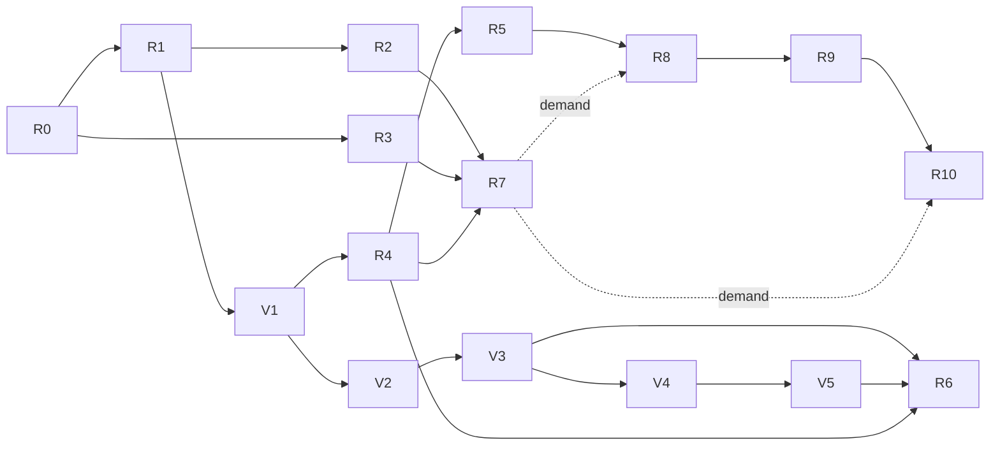

# Reactor application roadmap

Reactor turns a drawing into a working, data-backed web prototype, from one typed document
that people and AI edit through the same validated operations.

The first user is a designer who builds app prototypes for others to try: clients, teammates
or test users. Starting from a drawing, a screenshot or a sentence, they need screens that
navigate, controls that take input and sample data. Others open the result from a link, and the
designer keeps changing it as a design. Each milestone below says what this user can do after
it.

Planning date: 2026-10-14; variable foundation updated 2026-10-17. Work is planned unless
its implementation status explicitly says otherwise.
[REFACTOR_PLAN.md](REFACTOR_PLAN.md) keeps the earlier audit, its dated findings and its phases.

## Current state

| Capability                 | State                                                                                                                                                                                                                                                                                                                                                                                                                                                                                                                                                                                                                                                                                                              |
| -------------------------- | ------------------------------------------------------------------------------------------------------------------------------------------------------------------------------------------------------------------------------------------------------------------------------------------------------------------------------------------------------------------------------------------------------------------------------------------------------------------------------------------------------------------------------------------------------------------------------------------------------------------------------------------------------------------------------------------------------------------ |
| Drawing and editing        | Implemented and browser-tested: shapes, groups, layers, guides, snapping, inspector.                                                                                                                                                                                                                                                                                                                                                                                                                                                                                                                                                                                                                               |
| Components                 | Implemented: instances, overrides, nested sources, and copies from other documents updated on request ([componentLibrary.ts](src/app/componentLibrary.ts)).                                                                                                                                                                                                                                                                                                                                                                                                                                                                                                                                                        |
| Variables and templates    | Implemented, with one value per variable (`values.default`). A pure central resolver evaluates values and templates ([variableResolver.ts](src/app/variableResolver.ts)); bindings still write default values into shapes. Aliases, dimensions and packages remain planned.                                                                                                                                                                                                                                                                                                                                                                                                                                                                                                                         |
| Saving and collaboration   | Implemented: IndexedDB, tab sync, Yjs merges, server sync when signed in.                                                                                                                                                                                                                                                                                                                                                                                                                                                                                                                                                                                                                                          |
| Images                     | Implemented: content-addressed, shared with the server when signed in ([assetSync.ts](src/app/services/assetSync.ts)).                                                                                                                                                                                                                                                                                                                                                                                                                                                                                                                                                                                             |
| Accounts                   | Implemented: workspaces and document roles. People cannot yet share with others, and presence is off ([serverSync.ts](src/app/services/serverSync.ts) passes no awareness).                                                                                                                                                                                                                                                                                                                                                                                                                                                                                                                                        |
| Undo and redo              | Implemented: each person undoes and redoes their own changes to a document's records, also while others edit ([collaboration.ts](src/app/services/collaboration.ts)).                                                                                                                                                                                                                                                                                                                                                                                                                                                                                                                                              |
| Operations                 | Implemented: paste goes through `applyOperations`, applied whole as one undo step that records its author ([#177](https://github.com/jtasek/reactor/pull/177)).                                                                                                                                                                                                                                                                                                                                                                                                                                                                                                                                                    |
| AI                         | Gateway implemented: `/api/ai` streams operations from Claude Haiku 5.5 or any OpenAI-compatible provider, checked and repaired once, with daily limits, and recorded eval cases replayed in CI ([#178](https://github.com/jtasek/reactor/pull/178)). Edit with words has a movable, dockable chat with local conversation history; it proposes added, changed and deleted shapes, variables and groups, applied as one undo step once accepted ([#179](https://github.com/jtasek/reactor/pull/179)). Requests use the selection with its group, variable and component dependencies, or the document when nothing is selected, bounded to 32 KiB of UTF-8 JSON and 300 records ([context.ts](src/ai/context.ts)). |
| Screens, data and behavior | Absent. Links have loose endpoints and types without meaning, and the data view is a placeholder.                                                                                                                                                                                                                                                                                                                                                                                                                                                                                                                                                                                                                  |
| Export and runtime         | Absent. The editor's content security policy lets the page connect only to its own server and the sync server ([server.prod.ts](server.prod.ts)).                                                                                                                                                                                                                                                                                                                                                                                                                                                                                                                                                                  |

The editor surface depends on SVG: input converts through `getScreenCTM`
([helpers.ts](src/events/drivers/helpers.ts)) and shapes are measured with `getBBox`. That
stays; nothing below replaces the editor surface.

## Rules for every milestone

- Existing documents open, edit, save, copy and sync. Signed-out drawing works without a server.
- Until the public beta (R7), saved document formats change freely: bump the schema version
  and update readers and fixtures, with no migrations or fallbacks. From the beta on, a format
  change migrates saved documents, and published apps' public contracts, their API names and
  package format, stay compatible. Server tables always change through new migrations in
  `server/migrations.ts`; released ones are never edited.
- A new kind of durable record joins the readers, factories, copy and paste, collaboration and
  the merge repair in the same change: references to missing records are dropped, as deleting
  them would. A two-copy test covers a concurrent delete and reference.
- Actions stay synchronous and async work stays in services. Gestures commit synchronously.
- A new feature loads with its page or control. The entry bundle budget stays at 491 KiB, and
  248 KiB per file.
- A failed import, build or generation leaves working content and the last valid preview, and
  a result that arrives after a newer edit is dropped. Diagnostics name the record that caused
  them, and drafts are never deleted to make a build pass.
- Each step names its acceptance spec, a Vitest or Playwright file, and adds it in the same
  change. Generated output gets a byte snapshot per fixture, so regenerating is deterministic.
- CI runs lint, type checks, unit and server tests on PGlite, Chromium browser tests and the
  bundle budget, and recorded AI evals once AI lands. A nightly run, added with the first AI
  feature, runs live AI evals, a PostgreSQL container and other browsers. Physical devices are
  checked by hand, and the result records which ones.
- Imports are untrusted: packages, pasted data and screenshots. They have size, count and
  nesting limits, images are checked by their content as the server does, and text stays text.
- An adapter contract appears when its second implementation ships; until then, plain modules.
  First-party code comes before any third-party plugin.

## Architecture

### Document and identity

One document holds one application. Typed tables stay authoritative: shapes, components,
variables and the new records below. A pure graph reader exposes the relations between them;
there is no universal node and edge store. The generated application has its own contract,
apart from the store's `Application` type. IDs are stable and scoped to their document.
Copying records into another document remaps everything they depend on, and a name is a label
that never changes a reference.

A slice is what one view needs: a screen, or the selection, with every record it depends on
(components, variables, images and entities), read through the graph reader. The application
projection is the validated slice of an app's screens as plain data: frames, controls, layout,
data bindings and actions, with no store objects.

### Operations and undo

Undo works on the shared Yjs documents and tracks only this copy's own changes, so it covers
every existing action without rewriting it, and undoes a person's change even while others
edit. A gesture, a held key and an accepted AI proposal are one step each. R1 starts with a
spike that proves this with two copies.

Changes that arrive as data (AI proposals, imports, pastes) are typed operations applied by
`applyOperations`, one synchronous root action:

- every record it would write is checked with the durable readers;
- a reference must name an existing ID, or a temporary key made earlier in the same batch;
- it applies all or nothing, as one undo step;
- it records who made the batch: a person, or an AI request with its model.

### Screens

A component or an instance may declare a role (text, input, button, list, image) and the props
that role takes; there is no second tree of controls beside the drawing. "Make interactive"
sets a role by hand or from an AI suggestion; nothing infers roles silently.

Screens and stacks are frames, a new kind of record, because groups hold only shapes and are
selected whole. A frame has its own box and holds shapes and other frames, so frames nest. A
press inside a frame takes the shape under it, and a frame is selected by its edge, its name or
the explorer. A screen is a top-level frame, and a button's role may navigate to a screen.

A frame may be a stack:

- direction: row or column;
- gap, padding and alignment;
- each child's width and height: hug, fill or fixed, with a minimum and maximum.

The editor lays a stack out as part of the change that alters it, and again once other copies'
changes reach it. Layout depends only on the merged rules and sizes, so every copy writes the
same positions, and a merge never leaves a mix that no layout made. The preview and exported
apps apply the same rules with the browser's layout.

The preview runs in an iframe sandboxed without same-origin access, and receives the validated
application projection, never the store. Shared previews and published apps are served from a
separate registrable domain, one subdomain per app, without the editor's cookies. The editor's
preview frame loads from that domain too, so the editor's content security policy gains a
`frame-src` for it alone; a `srcdoc` or blob frame would inherit the editor's policy, which
blocks the runtime's scripts.

### Data

- **Entities** use a subset of JSON Schema:
    - string, number, integer, boolean, enum, date and a reference to another entity;
    - required fields, minimum and maximum, length and pattern.

    One vocabulary validates the preview's forms and later describes generated APIs.

- **Expressions** use a small typed grammar: field references, literals, comparisons, and `and`,
  `or` and `not`. Conditions, visibility and validation use it; there is no arbitrary code.
- **Sample records** live in the shared document, at most 1,000 per entity. Larger data comes
  from a provider.
- **Lists** bind an item template to an entity, and rows are keyed by record ID.
- **Form state, loaded records and requests** are runtime state, never saved in the document.

### Variables and design systems

The pure central resolver is the common source of evaluated variable values and template
reference diagnostics. Its first version preserves default values, materialized bindings,
name fallback, missing-reference placeholders and existing detachment rules. It changes no
saved records. Definition editors and serialization read raw definitions, not resolved text.

Next, bindings become explicit references: a normal value edit replaces or detaches a binding
through a defined action, rather than inferring its existence by comparing stored values.
Default values may remain materialized for compatibility. Rendering, bounds, hit testing,
layout and export must agree on resolution before a context can change geometry. Switching
context locally never rewrites shared shapes.

Aliases reference a compatible variable by ID and stay separate from text interpolation.
Primitive, semantic and component token layers are a useful convention, not a required depth.
Theme (Light/Dark) and Density (Comfortable/Compact) are independent dimensions; Brand follows
only when needed. Initially a token varies along one declared dimension, avoiding a combined
list of every possible mode. Cross-dimension overrides require a demonstrated use case and
explicit precedence. Responsive layout belongs to frames; locale belongs to content.

IDs identify variables; names and organizational paths label them. Native design-system
packages preserve source-package and token identity across import and update. A matching name
suggests a conflict resolution; it never silently establishes package identity. Existing
clipboard name-and-type matching remains unchanged until a separately tested change.

Design tokens, component inputs, runtime state and entity fields keep distinct ownership and
lifetimes, even if a future picker presents them together. Numeric meanings and units are added
with consumers: dimension, ratio and duration before compound typography or shadow values.
Plain numbers remain supported. The inspector should explain the selected context, alias
chain, final value, uses and any unresolved reference.

### AI

- **Gateway.** Model calls run on the server, at `/api/ai`, which checks the session, the role
  and the `Origin`. It holds the provider keys, limits use per workspace and per person, caches
  instructions and design-system context, and routes each task to a model through a provider
  adapter.
- **Operations only.** Models produce operations and nothing else: no document bytes, code or
  CSS. Operations are validated as above, which rejects references to records that do not
  exist. On failure, the diagnostics go back to the model once, then to the person.
- **Proposals.** Operations stream into a proposal view outside the shared document. Accepting
  applies them as one undo step. Cancel aborts the request in the browser and at the provider
  and discards the proposal. AI never changes a shared document unless a person accepts.
- **Context.** The selection and its slice, the components with their roles and props, the
  variables with their current values, and the entity schemas. It stays within a token budget.
  Images go only when attached, and other documents never.
- **Without AI.** `state.ai` is `unavailable` when the server has no AI configured, or when
  signed out. AI code loads lazily, and every AI feature speeds up something people can do by
  hand. A workspace can turn AI off.
- **Evals.** `tests/ai/cases/` holds cases: a document fixture, a prompt, an optional image, and
  assertions on the resulting document.
    - CI replays recorded model responses to test validation, repair, apply, cancel and undo.
    - A live run, nightly and on any change of model or prompt, reports pass rate, cost and
      latency, and fails on a drop of more than 3 points.

### Connectors and runtime

- **External data.** One read-only HTTP source, called through the server. Each workspace has
  an allowlist of destinations. Private and link-local addresses and DNS rebinding are blocked,
  and requests have time and response-size limits. Credentials stay on the server, never in
  documents or exports, and the editor's own policy keeps connecting only to its servers.
- **Exported web package.** It is static and runs without Reactor: no account, registry or
  editor is needed.
- **Hosted apps.** A published app runs an immutable, validated release on its own domain.
  App users and their permissions are separate from editor roles. Business records live in
  runtime storage, never in documents. A release keeps its images even when the draft changes.

## Budgets

| What                           | Budget                                                                  |
| ------------------------------ | ----------------------------------------------------------------------- |
| Projecting a slice             | 4 ms for 300 controls, 16 ms for 2,000 records; only on committed edits |
| Preview after a committed edit | 250 ms at p95                                                           |
| Shared document                | A warning at 5 MB of Yjs state                                          |
| Entry bundle                   | Unchanged: 491 KiB, 248 KiB per file                                    |
| Preview and runtime chunk      | 150 KiB                                                                 |
| AI chunk in the editor         | 40 KiB                                                                  |
| Exported runtime               | 60 KiB gzipped                                                          |
| AI edit                        | First operation shown within 2 s at p50                                 |
| AI screen                      | 20 s at p95                                                             |

## Milestones

### R0 Baseline (S)

The image-sync tests no longer need a busy machine to finish an upload within a second, and
README and REFACTOR_PLAN describe what exists. Done when `pnpm check` passes on master.

### R1 Operations and undo (M)

The user can undo and redo their own changes, also while others edit.

1. Spike: undo of this copy's own Yjs changes, applied back through the store, with two copies.
2. Undo and Redo commands, with one step per gesture or held key.
3. `applyOperations`, with validation and provenance; paste goes through it.

Done when `tests/undo.test.ts` (two copies) and `tests/browser/undo.spec.ts` pass.

### R2 AI gateway and edit with words (M)

The user describes a change in words, sees it proposed and accepts it.

Implementation status: the gateway, chat, bounded context and mutation operations are merged
in #178–#182. Forty cases now exercise both adapters offline, with a live evaluation command
and an opt-in nightly workflow. The additional reference answers are hand-authored fixtures;
their passing results do not establish model quality. Live validity, semantic accuracy, latency
and cost still need measurement with a configured provider, and the external-user gate below
remains open. Component creation as an AI operation is also not implemented; existing component
instances and source shapes can be edited.

1. The gateway with one provider adapter, usage limits and the recorded-response harness.
2. Edit with words: a lazy command that turns a request into operations on shapes, variables,
   components and alignment, with the proposal view, cancel and undo.

Done when, on 40 eval cases:

- at least 90% of runs give valid operations on the first try, and at least 97% after one repair;
- no invalid write reaches the document;
- the first change shows within 2 s at p50, and the whole one within 5 s at p95;
- one undo reverts it, and cancelling midway changes nothing;
- another copy sees nothing before acceptance;
- without AI, the entry is hidden and the entry bundle is unchanged.

Gate: ten people outside the team use it in their own work. Their accept and undo rates are
recorded.

### Variable foundation V1–V5 (incremental)

Each step ships a usable editor. V1 precedes R4; the later steps can proceed alongside screen
work, with V3 and V5 feeding R6. No speculative plugin or expression framework is needed.

1. **V1 — Central resolver, existing behavior (implemented).** One pure module evaluates
   variables and templates and reports reference problems. Actions, operations, clipboard,
   component overrides and editor diagnostics use it. Keep all four types, stored defaults,
   binding detachment and clamping, rename-safe templates and paste matching unchanged.
   Acceptance: `tests/variableResolver.test.ts` characterizes pure reads, zero/false/empty
   values, ID precedence and name fallback, cycles, diagnostic order and the depth limit;
   existing variable, template, operation, component and browser tests remain green.
2. **V2 — Typed aliases and explicit binding edits.** Add literal-or-reference definitions
   with compatible types, cycle and missing-reference diagnostics. Make edits explicitly
   replace or detach bindings; preserve resolved values when detaching. Update durable readers,
   operations, copying, collaboration and undo together. Show the resolution chain and uses.
   Acceptance: `tests/variableAliases.test.ts` covers invalid batches, rename/delete, copy,
   undo and concurrent delete/reference; `tests/browser/variables.spec.ts` covers bind, edit,
   detach and actionable diagnostics. Existing literals and templates still work.
   First increment implemented: direct shape/operation edits and visibility/lock commands
   detach explicitly replaced bindings immediately, including same-value writes; explicit
   operation bindings take precedence. Shared undo restores the references with their values.
   Covered by `tests/variables.test.ts`, `tests/operations.test.ts` and
   `tests/browser/variables.spec.ts`.
   Second increment implemented: same-type aliases reference stable IDs, retain a literal
   fallback and resolve through the shared resolver. Source selection, chain/value display,
   detach, local source deletion, durable readers, operations, clipboard dependencies,
   collaboration, undo and AI context/tool schemas support aliases. Tests cover cycles,
   incompatible/missing/forward sources, atomic batches, copy/paste, shared undo and concurrent
   deletion/cycles in `tests/variableAliases.test.ts`; browser coverage checks source selection,
   diagnostics, reload and detach. Concurrent missing sources use the retained fallback;
   concurrent cycles remain visible and diagnosable. Explicit gesture and indirect geometry
   detachment remain planned; V2 is not complete.
3. **V3 — Independent dimensions and local context.** Add Theme and Density, defaults and
   a local switch, with each variable varying along one dimension initially. Resolve all
   drawing and geometry consumers consistently before allowing geometry-changing density.
   Acceptance: `tests/variableDimensions.test.ts` covers fallback and two copies in different
   contexts without shared writes; `tests/browser/variableDimensions.spec.ts` checks drawing,
   selection bounds, hit testing and local switching. Add preview/export parity checks when
   those consumers land in R4/R5. Existing documents use their default values.
4. **V4 — Native design-system packages.** Export and import a minimal versioned package of
   variables and their dependencies, preserving package/token identity. Preview conflicts and
   offer explicit reuse, replace or import separately; labels alone never trigger an update.
   Apply validated imports atomically through operations, as one undo step.
   Acceptance: `tests/designSystemPackages.test.ts` covers deterministic round trips, renamed
   tokens, ID remapping, missing dependencies, rejected imports, updates and undo;
   `tests/browser/designSystemPackages.spec.ts` covers the conflict choices and unchanged
   content after a rejected import. Package export never includes runtime state.
5. **V5 — Interchange and richer types as needed.** Add a DTCG adapter for the supported
   subset, reporting unsupported constructs rather than silently flattening them. Add numeric
   semantics and units only alongside their first properties and validation; compound types
   follow consumers. Keep the native model independent of the interchange format.
   Acceptance: `tests/designTokenInterchange.test.ts` covers supported round trips, alias
   identity, units, unsupported-input diagnostics and failure without document changes.

### R3 Sharing and presence (M)

The user shares a document and sees who else is in it.

1. Invitations to a workspace or a document, and viewer links.
2. Presence: names, colors, pointers and selections.
3. Comments on the canvas, in a change of their own.

Done when `tests/server/sharing.test.ts` (invited roles, read-only viewer links) and
`tests/browser/presence.spec.ts` (two pages see each other's pointers and selections) pass.

### R4 Interactive screens (XL)

The user turns a drawing into screens that navigate and take input, and sends a link to them.

1. Frames for screens and stacks, and roles and props on components and instances, set in the
   inspector, with keyboard access. A spike first proves stacks laid out again after merges
   across two copies.
2. The sandboxed preview, with navigation, input state, diagnostics and the last valid preview.
3. Preview links: read-only, on the separate domain.
4. SVG export of a screen or a selection, reusing geometry, order, visibility and overrides.
5. Starter templates (list and detail, form, sign-in, settings), and empty states for the new
   panels.
6. AI: a screen from a prompt or a screenshot, in the document's components and variables.
   Done when:
    - at least 80% of 30 screenshots are rated a usable start by two reviewers;
    - when the document has a matching component, at least 70% of controls are its instances;
    - a color within ΔE 2 of a color variable is bound to it;
    - it finishes within 20 s at p95.

Steps 1 to 5 are done when `tests/frames.test.ts` (nesting, selection, layout after merges by
two copies) and `tests/browser/screens.spec.ts` (build two screens, navigate and type in the
preview, open the preview link, export SVG) pass.

Gate: people outside the team send preview links to others.

### R5 Data and forms (L)

The user shows a list of customers, opens one, edits it with validation, and exports the
prototype.

1. Entities, sample records and their editor, with schema diagnostics.
2. A list bound to an entity through an item template, and a details screen that receives the
   record.
3. A form with validation written as expressions, updating local records. The preview resets
   them on request.
4. Export as a standalone web package.
5. AI: an entity and 20 records from a description or pasted CSV or JSON, with a list bound to
   them. Done when:
    - at least 90% of field types are right;
    - every record passes validation;
    - renaming a field keeps its bindings.

Steps 1 to 4 are done when `tests/data.test.ts` (schemas, expressions, list keys by record ID)
and `tests/browser/dataForms.spec.ts` (list, details, rejected and saved edits, the exported
package behaving as the preview) pass.

Afterward, agent mode: the AI plans, proposes, previews and asks for acceptance in rounds with
the user.

### R6 Themes (M)

The user switches a prototype between Light and Dark, and checks it for accessibility.

1. Bring V2/V3 aliases and independent dimensions to prototypes, using the same resolver
   in the editor, preview and exported app; verify local context and geometry agree.
2. Expose V4/V5 package and supported DTCG interchange in the design-system workflow.
3. Audits in the preview: contrast, labels and focus order, with fixes the AI can propose.

Done when `tests/themes.test.ts` (the preview and exported app resolving aliases and dimensions
as the editor does, which V2's `tests/variableAliases.test.ts` and V3's
`tests/variableDimensions.test.ts` cover there) and `tests/browser/themes.spec.ts` (switching
Light and Dark in the preview, and the audits) pass.

### R7 Public beta (S)

Anyone can sign up. Compatibility rules begin here: saved documents migrate, and published
apps' contracts stay compatible. Track two measures:

- how many new people share a preview with at least two screens within a day;
- how many prototype sessions each week are run by someone other than the author.

R8 and R10 start only if beta users ask for real data and for publishing.

### R8 One HTTP source (L)

The user's list shows live records from an API, with loading, empty, error and retry states,
and falls back to sample records for offline work. The source runs through the server proxy
with the connector rules above. Pagination, filtering and sorting follow, as the source needs
them.

Done when `tests/server/connector.test.ts` (allowlist, private addresses and DNS rebinding
refused, time and size limits, no credentials in exports) and `tests/browser/liveData.spec.ts`
(each state, a stale request canceled, the offline fallback) pass.

### R9 Workflows (L)

The user sees and edits what a screen does as a diagram of the same events and actions.

- Conditions, success and error branches, and a bounded interpreter with cancellation.
- Traces stay local, and reloading never replays an action.
- Moving a node in the diagram never changes behavior.

Done when `tests/workflows.test.ts` (branches, cancellation, run bounds, no replay on reload,
moved nodes) and `tests/browser/workflows.spec.ts` pass.

### R10 Hosted runtime and generated API (XL)

The user publishes the prototype, and it reads and writes real records.

1. Release records with immutable, atomic activation; a failed build keeps the running app.
2. App users and their permissions; record storage per app; tests that apps and users are
   isolated from each other.
3. Generated list, create and update operations, described in OpenAPI from the entity schemas,
   with server validation, transactions and idempotent retries.

Done when `tests/server/runtime.test.ts` (atomic activation, isolation between apps and users,
refused invalid and forbidden requests, retries that change nothing twice) passes.

### Later, on evidence

- Advanced package publishing and update policies beyond V4's explicit import/update choices.
- DTCG constructs beyond the subset validated in V5.
- Contract diffs and migrations for published APIs.
- Other export formats.

### Not planned

- A Canvas preview or editor.
- A 3D view.
- Native iOS and Android targets.
- XML.
- Third-party plugin hosting.

Revisit only when users ask for them.

## Decisions

| Decision               | Default                                                                                                                                                                                                                                                                             | Decide by |
| ---------------------- | ----------------------------------------------------------------------------------------------------------------------------------------------------------------------------------------------------------------------------------------------------------------------------------- | --------- |
| Semantics              | Roles and props on components and instances; screens and stacks are frames, which nest                                                                                                                                                                                              | Before R4 |
| Stack positions        | Written by the change that alters the stack, and again after merges                                                                                                                                                                                                                 | R4 step 1 |
| Where apps run         | Hosted previews and apps, with the exported web package as the exit; self-hosting later                                                                                                                                                                                             | R4 step 3 |
| Models                 | Claude Opus 5.5 for screens from screenshots and for agent mode, and Claude Haiku 5.5 for edits and audits. Claude Sonnet 5.5 is evaluated for generation, chosen by eval score per cost. A server may name another provider speaking OpenAI's Chat Completions API, and its models | Before R2 |
| AI in shared documents | Proposals that a person accepts                                                                                                                                                                                                                                                     | R2        |
| AI data                | Only what a request needs; providers do not train on it; AI can be turned off per workspace                                                                                                                                                                                         | Before R2 |
| Modes in the editor    | Independent dimensions through the central resolver; a person's context stays local                                                                                                                                                                                                                                 | V3        |
| Compatibility          | None before the public beta                                                                                                                                                                                                                                                         | R7        |

## Keeping this plan current

- After each milestone, update Current state and README, and link the change that delivered
  it.
- Describe new conventions in AGENTS.md once they exist in code, not before.
