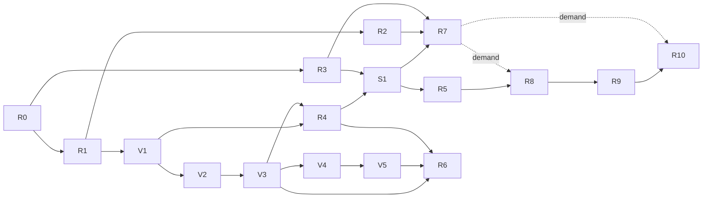

# Reactor application roadmap

Reactor turns a drawing into a working, data-backed web prototype, from one typed document
that people and AI edit through the same validated operations.

The first user is a designer who builds app prototypes for others to try: clients, teammates
or test users. Starting from a drawing, a screenshot or a sentence, they need screens that
navigate, controls that take input and sample data. Others open the result from a link, and the
designer keeps changing it as a design. Each milestone below says what this user can do after
it.

Planning date: 2026-10-14; variable foundation updated 2026-10-17; screen/view and responsive
model updated 2026-10-23; current state, budgets and the S1 milestone added 2026-11-09 after a
roadmap and architecture review. Work is planned unless it says it is built; what each built
step delivered is in the [delivery log](DELIVERY_LOG.md).
[REFACTOR_PLAN.md](REFACTOR_PLAN.md) keeps the earlier audit, its dated findings and its phases.

## Current state

| Capability                 | State                                                                                                                                                                                                                                                                                                                                                                                                                                                                                                                                                                                                                                                                                                              |
| -------------------------- | ------------------------------------------------------------------------------------------------------------------------------------------------------------------------------------------------------------------------------------------------------------------------------------------------------------------------------------------------------------------------------------------------------------------------------------------------------------------------------------------------------------------------------------------------------------------------------------------------------------------------------------------------------------------------------------------------------------------ |
| Drawing and editing        | Implemented and browser-tested: shapes, groups, layers, guides, snapping, inspector.                                                                                                                                                                                                                                                                                                                                                                                                                                                                                                                                                                                                                               |
| Components                 | Implemented: instances, overrides, nested sources, and copies from other documents updated on request ([componentLibrary.ts](src/app/componentLibrary.ts)).                                                                                                                                                                                                                                                                                                                                                                                                                                                                                                                                                        |
| Variables and templates | Implemented: central resolver, explicit bindings, typed aliases, opt-in user-defined dimensions inherited per Screen view, contextual numeric/text modes for supported consumers (R4.4), native design-system packages and a bounded DTCG adapter. Local simulation stays separate from authored frame/view/instance overrides. |
| Saving and collaboration   | Implemented: IndexedDB, tab sync, Yjs merges, server sync when signed in.                                                                                                                                                                                                                                                                                                                                                                                                                                                                                                                                                                                                                                          |
| Images                     | Implemented: content-addressed, shared with the server when signed in ([assetSync.ts](src/app/services/assetSync.ts)).                                                                                                                                                                                                                                                                                                                                                                                                                                                                                                                                                                                             |
| Accounts | Implemented: email, Google and GitHub sign-in, password reset, workspaces, member management, workspace invitations with sharing/acceptance UI, and a read-only viewer preview. Presence: other people's named pointers and selections on the canvas (S1 step 3). Not built: document-level invitations, comments and account deletion. Admins turn AI on or off per workspace on Sharing (S1 step 4). Once signed in, the editor offers to move this browser's signed-out documents into the account (S1 step 5). |
| Undo and redo              | Implemented: each person undoes and redoes their own changes to a document's records, also while others edit ([collaboration.ts](src/app/services/collaboration.ts)).                                                                                                                                                                                                                                                                                                                                                                                                                                                                                                                                              |
| Operations                 | Implemented: paste goes through `applyOperations`, applied whole as one undo step that records its author ([#177](https://github.com/jtasek/reactor/pull/177)).                                                                                                                                                                                                                                                                                                                                                                                                                                                                                                                                                    |
| AI                         | Gateway implemented: `/api/ai` streams operations from Claude Haiku 5.5 or any OpenAI-compatible provider, checked and repaired once, with daily limits, and recorded eval cases replayed in CI ([#178](https://github.com/jtasek/reactor/pull/178)). Edit with words has a movable, dockable chat with local conversation history; it proposes added, changed and deleted shapes, variables and groups, applied as one undo step once accepted ([#179](https://github.com/jtasek/reactor/pull/179)). Requests use the selection with its group, variable and component dependencies, or the document when nothing is selected, bounded to 32 KiB of UTF-8 JSON and 300 records ([context.ts](src/ai/context.ts)). |
| Screens, data and behavior | Implemented: frames and stacks with hug/fill sizing, explicit screens with equal Screen views, alternate and automatic screen layouts, component variants (manual and responsive by width), roles, Activate → Navigate interactions, Flow (`/flow`), interactive variants, visibility and named yes/no, text and number state with set/toggle/reset actions. Data: entities with Text/Number/Boolean fields, sample records, choice and reference fields, the 1,000-record limit, repeated lists, list-to-detail records, session-only record forms, validation rules written as condition trees, and Edit with words making entities, records and lists (R5.1–R5.5). Not built: dates, and actions on the shared vocabulary. |
| Export and runtime | Implemented: sandboxed Preview, the Prototype player (`/prototype`), read-only prototype links on the separate preview domain, SVG export, starter templates and a downloadable standalone web package (R5.4). |

The editor surface depends on SVG: input converts through `getScreenCTM`
([helpers.ts](src/events/drivers/helpers.ts)) and shapes are measured with `getBBox`. That
stays; nothing below replaces the editor surface.

## Glossary

The words the editor, this plan and the AI instructions use. Stored names stay as they were, so
documents, shared links (preview protocol v3) and AI operations keep working.

| Word | Meaning | Stored as |
| --- | --- | --- |
| Page | A destination with one design (was "Screen"). Only a frame on Canvas can be a Page; one nested in another frame is a frame. | `Frame.kind === 'screen'` |
| Page at a size | A Page shown on the canvas at a size and modes, named like "Home · Mobile". The UI has no noun for it: "Show on canvas", "Show at size…", "Remove from canvas". | `Frame.kind === 'view'` |
| Main design | A Page's own artwork, shared by every size that shows it. | the Page's frame tree |
| Separate design | A Page's own tree for some sizes; edits there don't reach the others. Starts as a copy of the design shown. | `screenLayout` frame, rules in `responsiveLayouts` |
| Layout | Only a frame's stack: Free, Row or Column. | `stack` |
| Sizes | The one variable dimension selected by page width. A later width-selected dimension counts as manual. | dimension with `selection: 'width'` |
| Data | Where entities and records are edited (was "Data View"). | `dataEntities`, `dataRecords` |

## Rules for every milestone

- Existing documents open, edit, save, copy and sync. Signed-out drawing works without a server.
- Schema changes preserve documents supported by the current reader: bump the version and
  provide a tested conversion when records or references change. In particular, introducing
  screens/views must preserve frame artwork and existing navigation targets. Pre-beta internal
  contracts may evolve; from R7, published apps' public contracts, API names and package format
  also stay compatible. Server tables always change through new migrations in
  `server/migrations.ts`; released ones are never edited.
- A new kind of durable record joins the readers, factories, copy and paste, collaboration and
  the merge repair in the same change: references to missing records are dropped, as deleting
  them would. A two-copy test covers a concurrent delete and reference.
- Actions stay synchronous and async work stays in services. Gestures commit synchronously.
- A new feature loads with its page or control. The entry bundle budget stays at 410 KiB (set in
  `webpack.config.mjs`), and 232 KiB per file.
- A failed import, build or generation leaves working content and the last valid preview, and
  a result that arrives after a newer edit is dropped. Diagnostics name the record that caused
  them, and drafts are never deleted to make a build pass.
- Each step names its acceptance spec, a Vitest or Playwright file, and adds it in the same
  change. Generated output gets a byte snapshot per fixture, so regenerating is deterministic.
- CI runs lint, type checks, unit and server tests on PGlite, Chromium browser tests and the
  bundle budget, and recorded AI evals once AI lands. A nightly run, added with the first AI
  feature, runs live AI evals, a PostgreSQL container and other browsers. Physical devices are
  checked by hand, and the result records which ones.
- Imports are untrusted: packages, pasted data and screenshots. They have size, count and
  nesting limits, images are checked by their content as the server does, and text stays text.
- An adapter contract appears when its second implementation ships; until then, plain modules.
  First-party code comes before any third-party plugin.

## Architecture

### Document and identity

One document holds one application. Typed tables stay authoritative: shapes, components,
variables and the new records below. A pure graph reader exposes the relations between them;
there is no universal node and edge store. The generated application has its own contract,
apart from the store's `Application` type. IDs are stable and scoped to their document.
Copying records into another document remaps everything they depend on, and a name is a label
that never changes a reference.

A slice is what one view needs: a screen, or the selection, with every record it depends on
(components, variables, images and entities), read through the graph reader. The application
projection is the validated slice of an app's screens as plain data: frames, controls, layout,
data bindings and actions, with no store objects.

### Operations and undo

Undo works on the shared Yjs documents and tracks only this copy's own changes, so it covers
every existing action without rewriting it, and undoes a person's change even while others
edit. A gesture, a held key and an accepted AI proposal are one step each. R1 starts with a
spike that proves this with two copies.

Changes that arrive as data (AI proposals, imports, pastes) are typed operations applied by
`applyOperations`, one synchronous root action:

- every record it would write is checked with the durable readers;
- a reference must name an existing ID, or a temporary key made earlier in the same batch;
- it applies all or nothing, as one undo step;
- it records who made the batch: a person, or an AI request with its model.

### Screens, canvas views and responsive components

The canvas is a design workspace that may show many screens, and many views of the same screen,
at once. It never executes navigation or input behavior. Ordinary frames and loose artwork may
coexist with screen views. Flow and Prototype are separate features that the person invokes;
neither is a mode silently entered by clicking a drawn control.

There is one shared, pannable and zoomable design canvas, not one editor canvas per screen.
Home, Checkout, Settings and ordinary layout frames can all be visible and editable side by
side. A second size or mode view of Home is optional. "Screen view" means a placed frame-like
representation on this same canvas, not a separate page, tab or running prototype.

For example, one canvas may contain Home (phone, Dark), Home (desktop, Light), Checkout
(phone, Dark), Settings (tablet), a free-standing component study frame and loose artwork.
Selecting any of these does not hide the others or navigate the application. Create screen
places an editable screen on the canvas directly; managing a separate definition first is
not a prerequisite in the user interface.

| Concept | Authored responsibility | Local presentation/runtime state |
| --- | --- | --- |
| Screen definition | Stable destination ID, name, default layout and optional responsive layouts; owns content and component instances through existing frame trees. | Selection of its currently resolved layout. |
| Screen view | Stable view ID, reference to one screen, canvas position, viewport dimensions and optional mode overrides for comparison. | Selection, hover, measurement caches and temporary inspection settings. |
| Component | Shapes and nested instances, variable bindings, stable exposed property IDs, optional role and variant family. | Resolved appearance within the current instance path and context. |
| Interaction | Trigger and typed action on a screen/control; navigation references a screen ID. | Executed only inside an invoked prototype session. |
| Flow view | Optional saved diagram positions for screen nodes; edges come from the same interaction records. | Diagram selection and diagnostics; opening it executes nothing. |
| Prototype session | Launch configuration may name a start screen, size and modes. | Current screen, navigation history, input values and mode/viewport changes; never document edits. |

Names are labels, not identity. A screen is explicitly defined, not permanently inferred from
being a top-level frame. Initial conversion keeps the current runtime's top-level-frame screens
working; new ordinary frames do not silently become navigation destinations.

A screen view references a definition rather than copying its shapes. Editing content through
one view edits the definition and updates every view; moving/resizing the view or changing its
mode overrides edits only that view's configuration. Creating another view and duplicating a
screen definition are separate commands. Deleting a view leaves its screen and navigation
intact; deleting a screen identifies affected views/actions and supports undo. Unresolved
concurrent references remain diagnosable without silently redirecting to another screen.

Each projected object is addressed by view ID, instance path and source object ID. Rendering,
selection, hit testing, text measurement and gestures use that same address and transform.
Canvas placement is separate from layout coordinates inside the screen. A repeated view can
therefore resolve different geometry without creating duplicate authored shapes or IDs.
Explorer nests the resolved contents under each screen view, identifies the shared screen and
its size/context, and preserves a way to edit the source definition. Global layers remain an
independent organization mechanism; they do not determine screens or navigation.

Frames retain Free/Row/Column layout, gap, padding, alignment and fixed/hug/fill sizing with
min/max constraints. Responsive layout first uses those rules. A screen may later explicitly
provide alternate layout trees for cases continuous reflow cannot express; all layouts retain
one screen destination, and reusable components/compatible property IDs carry shared content.
Creating an alternate layout is an explicit authoring operation, not a copy on every resize.

Component variants share a stable public property/role contract; variant artwork may differ.
An instance uses the default variant, an explicit variant, or Auto. Auto initially uses ordered,
unique minimum-width thresholds plus a base variant. Its author selects screen width or the
available inner width of its layout parent; these are distinct contexts, never guessed device
names. The greatest matching threshold wins, with exact boundary behavior defined in tests.
Different instances of one component may resolve different variants simultaneously. Content,
variable bindings, compatible overrides and interactions survive variant switches.

Variant choice and layout form one bounded resolution process. A rule must not oscillate because
its chosen variant changes the hug width that selects that variant. Diagnose such dependencies
and use a deterministic authored fallback variant/size; never write the computed choice or
geometry to shared state. Inspector explains the active mode, variant, width source and rule.

### Invoked Flow and Prototype features

Roles (Text, Input, Button, List, Image) describe semantics and typed property links. Actions
such as Navigate describe behavior separately. A Button role alone does not cause navigation;
its interaction chooses the destination. Keep the drawing's component tree as the control tree.
Actions address logical controls/property IDs, not transient canvas-view or variant artwork IDs.

Flow opens on explicit request and visualizes screen definitions and their authored actions.
Several canvas views of Home produce one Home flow node. Choosing a control and target in Flow
edits the same interaction as Inspector. Moving a flow node changes only diagram placement.
Canvas coordinates never define navigation order. R9 later extends these actions with conditions
and asynchronous branches rather than introducing another behavior graph.

Prototype opens on explicit request, using a chosen start screen, viewport and modes, optionally
seeded from a selected canvas view. Buttons execute actions and inputs accept values only there.
Navigation retains the session's viewport and mode selections and resolves the target
screen's layout/variants anew; it never navigates to a particular canvas view. Session selections
occupy the same precedence as canvas-view overrides; descendant overrides still apply. Flow need not be open or configured to run an authored
interaction. Reset/close clears session state without changing canvas view settings or content.

Evolve the existing Preview implementation into this Prototype feature; keep its invocation
working between increments. It runs in an iframe sandboxed without same-origin access and
receives a validated plain-data application projection, never the store. Shared prototypes and
published apps use the existing separate-site hosting boundary without editor cookies. Flow
and Prototype load only when invoked; the canvas editor remains usable without runtime hosting.

### Data

- **Entities** use a subset of JSON Schema:
    - string, number, integer, boolean, enum, date and a reference to another entity;
    - required fields, minimum and maximum, length and pattern.

    One vocabulary validates the preview's forms and later describes generated APIs.

- **Expressions** use a small typed grammar: field references, literals, comparisons, and `and`,
  `or` and `not`. Conditions, visibility and validation use it; there is no arbitrary code.
- **Sample records** live in the shared document, at most 1,000 per entity. Larger data comes
  from a provider.
- **Lists** bind an item template to an entity, and rows are keyed by record ID.
- **Form state, loaded records and requests** are runtime state, never saved in the document.

### Variables and design systems

The pure central resolver evaluates variable values, aliases and template reference
problems. Explicit binding edits replace or detach references; definition editors and serializers
read authored definitions, not their resolved appearance. Existing defaults remain supported.

Mode selection resolves independently for each optional dimension, from broadest to nearest:

1. Authored application defaults, or the dimension's default when not specified.
2. Local editor simulation selections for the application (canvas only).
3. Explicit screen overrides.
4. Explicit canvas-view overrides, or local Prototype session selections when running.
5. Overrides on containing frames and component instances, outermost to innermost.

An absent entry means inherit that dimension, not reset every dimension. A variable with no
matching mode value uses its existing base/alias fallback. Dimensions and modes use stable IDs;
missing/deleted choices produce a diagnostic and a defined fallback. Changing an ancestor's
Theme affects all descendants that have not explicitly overridden Theme, including nested
components. A locally selected mode never edits authored definitions or view settings. An
explicitly authored view override is saved/shared so comparison views reopen as designed.
When launching Prototype from a view, snapshot its effective screen-root modes, before child
overrides, into session selections at the same precedence. This keeps the launch appearance
consistent even when the view overrides its screen. Manual launch may leave dimensions at
Inherit; reset of a session selection restores the destination screen/application defaults.
Thereafter session choices persist across navigation without retaining a live link to the view.

Initially extend the existing color projection. Enable numeric/text modes only once rendering,
layout, bounds, hit testing, templates and export agree for supported consumers. Resolve each
view independently: caches must include view, instance path, modes and available size, and
invalidate on dependent edits. No mode switch writes resolved values into shared shapes.

Aliases reference a compatible variable by ID and stay separate from text interpolation.
Primitive, semantic and component token layers are a useful convention, not a required depth.
Dimensions and modes are opt-in and user-defined. Theme (Light/Dark), Density
(Comfortable/Compact) and Brand are examples, not mandatory built-ins. Initially a token varies along one declared dimension, avoiding a combined
list of every possible mode. Cross-dimension overrides require a demonstrated use case and
explicit precedence. Responsive layout belongs to frames; locale belongs to content.

IDs identify variables; names and organizational paths label them. Native design-system
packages preserve source-package and token identity across import and update. A matching name
suggests a conflict resolution; it never silently establishes package identity. Existing
clipboard name-and-type matching remains unchanged until a separately tested change.

Design tokens, component inputs, runtime state and entity fields keep distinct ownership and
lifetimes, even if a future picker presents them together. Numeric meanings and units are added
with consumers: dimension, ratio and duration before compound typography or shadow values.
Plain numbers remain supported. The inspector should explain the selected context, alias
chain, final value, uses and any unresolved reference.

### AI

- **Gateway.** Model calls run on the server, at `/api/ai`, which checks the session, the role
  and the `Origin`. It holds the provider keys, limits use per workspace and per person, caches
  instructions and design-system context, and routes each task to a model through a provider
  adapter.
- **Operations only.** Models produce operations and nothing else: no document bytes, code or
  CSS. Operations are validated as above, which rejects references to records that do not
  exist. On failure, the diagnostics go back to the model once, then to the person.
- **Proposals.** Operations stream into a proposal view outside the shared document. Accepting
  applies them as one undo step. Cancel aborts the request in the browser and at the provider
  and discards the proposal. AI never changes a shared document unless a person accepts.
- **Context.** The selection and its slice, the components with their roles and props, the
  variables with their current values, and the entity schemas. It stays within a token budget.
  Images go only when attached, and other documents never.
- **Without AI.** `state.ai` is `unavailable` when the server has no AI configured, or when
  signed out. AI code loads lazily, and every AI feature speeds up something people can do by
  hand. A workspace can turn AI off.
- **Evals.** `tests/ai/cases/` holds cases: a document fixture, a prompt, an optional image, and
  assertions on the resulting document.
    - CI replays recorded model responses to test validation, repair, apply, cancel and undo.
    - A live run, nightly and on any change of model or prompt, reports pass rate, cost and
      latency, and fails on a drop of more than 3 points.

### Connectors and runtime

- **External data.** One read-only HTTP source, called through the server. Each workspace has
  an allowlist of destinations. Private and link-local addresses and DNS rebinding are blocked,
  and requests have time and response-size limits. Credentials stay on the server, never in
  documents or exports, and the editor's own policy keeps connecting only to its servers.
- **Exported web package.** It is static and runs without Reactor: no account, registry or
  editor is needed.
- **Hosted apps.** A published app runs an immutable, validated release on its own domain.
  App users and their permissions are separate from editor roles. Business records live in
  runtime storage, never in documents. A release keeps its images even when the draft changes.

### Operations

The server runs as one Node process that holds open documents in memory
([sync.ts](server/sync.ts)) and keeps each document's latest Yjs state in `document_states`.
That suits the beta on one machine. Before R7:

- **History.** The server keeps snapshots of each document (hourly for a day, daily for a
  month) and offers Restore, which applies as a new change everyone sees. Shared undo stays
  per person and per session.
- **Backups.** A documented PostgreSQL backup and a restore drill, run before the beta and
  then on a schedule.
- **Signals.** Server metrics for sync connections, save failures, AI latency and errors and
  preview builds, and a browser error report. The budgets above are checked against them.
- **Version check.** The shared document records the lowest reader version that can edit it.
  A copy of the editor that is older goes read-only and offers Reload; the server also refuses
  builds older than the deployed one at connect time.
- **Shared server code.** Code the server imports from the client lives in one folder that the
  Docker image copies whole, and lint keeps server imports inside it.
- **Scale-out, when needed.** Route each document to one process (sticky by document ID) or
  share updates between processes; a restart during an edit is part of the Docker smoke test.

## Budgets

| What                           | Budget                                                                  |
| ------------------------------ | ----------------------------------------------------------------------- |
| Projecting a slice             | 4 ms for 300 controls, 16 ms for 2,000 records; only on committed edits |
| Preview after a committed edit | 250 ms at p95                                                           |
| Shared document                | A warning at 3 MiB of Yjs state; the server accepts at most 4 MiB on first sync (S1 step 6) |
| Entry bundle                   | 410 KiB (401.4 KiB on 2026-11-16), 232 KiB per file                     |
| Preview and runtime chunk      | 150 KiB                                                                 |
| AI chunk in the editor         | 40 KiB                                                                  |
| Exported runtime               | 60 KiB gzipped                                                          |
| AI edit                        | First operation shown within 2 s at p50                                 |
| AI screen                      | 20 s at p95                                                             |

## Milestones

### R0 Baseline (S)

The image-sync tests no longer need a busy machine to finish an upload within a second, and
README and REFACTOR_PLAN describe what exists. Done when `pnpm check` passes on master.

### R1 Operations and undo (M)

The user can undo and redo their own changes, also while others edit.

1. Spike: undo of this copy's own Yjs changes, applied back through the store, with two copies.
2. Undo and Redo commands, with one step per gesture or held key.
3. `applyOperations`, with validation and provenance; paste goes through it.

Done when `tests/undo.test.ts` (two copies) and `tests/browser/undo.spec.ts` pass.

### R2 AI gateway and edit with words (M)

The user describes a change in words, sees it proposed and accepts it.

Built: the gateway, chat, bounded context and mutation operations; see the
[delivery log](DELIVERY_LOG.md#r2-ai-gateway-and-edit-with-words). Still open: live validity,
accuracy, latency and cost measured with a configured provider, component creation as an AI
operation, and the external-user gate below.

1. The gateway with one provider adapter, usage limits and the recorded-response harness.
2. Edit with words: a lazy command that turns a request into operations on shapes, variables,
   components and alignment, with the proposal view, cancel and undo.

Done when, on 40 eval cases:

- at least 90% of runs give valid operations on the first try, and at least 97% after one repair;
- no invalid write reaches the document;
- the first change shows within 2 s at p50, and the whole one within 5 s at p95;
- one undo reverts it, and cancelling midway changes nothing;
- another copy sees nothing before acceptance;
- without AI, the entry is hidden and the entry bundle is unchanged.

Gate: ten people outside the team use it in their own work. Their accept and undo rates are
recorded.

Authoring usability follow-up, driven by the local screenshot benchmark:

1. **Shared descriptions (implemented).** AI and Inspector share component property metadata;
   AI receives property types and source defaults, semantic role links and variant dependencies.
   Variable context distinguishes authored values from effective values and their mode sources.
   A selected Screen view supplies its inherited context; source selections and document defaults
   are explicitly labelled. Existing context size limits and document data remain unchanged.
2. **Scoped screen artwork (implemented).** A screen authoring helper compiles local artwork
   references into the existing validated operation batch. Existing IDs and repeated local names
   on different screens cannot redirect instance references. Repeated names within one screen
   are rejected. Acceptance, collaboration and one-step undo retain the existing behavior.
3. **Layout intent (first increment implemented).** `composeScreen` provides explicit visible
   text, labeled component controls, ordered column content, padding/gaps, a bottom footer
   and palette bindings. Reactor computes positions using text measurement and natural control sizes.
   It rejects clipped/overlapping content through the existing repair flow. It compiles into
   existing frame/shape operations, without a template lookup or new document schema.
   Next: expose existing stack, sizing and constraints through validated authoring commands,
   with diagnostics that identify which constraint needs attention.
4. **Consistent editing context.** Show shared source, per-view context and instance overrides
   consistently in Inspector; use the same descriptions for AI explanations.
5. **Rendered proposals (first increment implemented).** Completed proposals show a temporary
   visual draft in chat, with an enlarged inspection view. The draft uses the existing operation
   staging and artwork renderer, refreshes against current document edits, and reports invalidated
   proposals. Drafts stay outside durable document data; Accept still applies the atomic batch.
   Next: targeted repair of a proposed result without accepting it first.

Steps 1–2 address authoring ambiguity; they do not complete the live screenshot-quality gate.
Measure the same 30 references again before claiming a quality or latency improvement.

### Variable foundation V1–V5 (incremental)

Each step ships a usable editor. V1 precedes R4; the later steps can proceed alongside screen
work, with V3 extended by R4.3–R4.4 and V5 feeding R6. No speculative plugin or expression framework is needed.

1. **V1 — Central resolver, existing behavior (implemented).** One pure module evaluates
   variables and templates and reports reference problems. Actions, operations, clipboard,
   component overrides and editor diagnostics use it. Keep all four types, stored defaults,
   binding detachment and clamping, rename-safe templates and paste matching unchanged.
   Acceptance: `tests/variableResolver.test.ts` characterizes pure reads, zero/false/empty
   values, ID precedence and name fallback, cycles, diagnostic order and the depth limit;
   existing variable, template, operation, component and browser tests remain green.
2. **V2 — Typed aliases and explicit binding edits (implemented).** Add literal-or-reference definitions
   with compatible types, cycle and missing-reference diagnostics. Make edits explicitly
   replace or detach bindings; preserve resolved values when detaching. Update durable readers,
   operations, copying, collaboration and undo together. Show the resolution chain and uses.
   Acceptance: `tests/variableAliases.test.ts` covers invalid batches, rename/delete, copy,
   undo and concurrent delete/reference; `tests/browser/variables.spec.ts` covers bind, edit,
   detach and actionable diagnostics. Existing literals and templates still work.
   First increment implemented: direct shape/operation edits and visibility/lock commands
   detach explicitly replaced bindings immediately, including same-value writes; explicit
   operation bindings take precedence. Shared undo restores the references with their values.
   Covered by `tests/variables.test.ts`, `tests/operations.test.ts` and
   `tests/browser/variables.spec.ts`.
   **Large-library workspace (implemented):** `/variables` provides a full-page editor,
   name/path search, independent list/editor scrolling and direct canvas navigation. Existing
   definitions, mode rules and import/export use the same editing logic. The compact panel
   remains available for canvas-side editing. Browser coverage exercises 600 variables,
   direct visits, reload, narrow layouts, draft protection, history and view-only access.
   Second increment implemented: same-type aliases reference stable IDs, retain a literal
   fallback and resolve through the shared resolver. Source selection, chain/value display,
   detach, local source deletion, durable readers, operations, clipboard dependencies,
   collaboration, undo and AI context/tool schemas support aliases. Tests cover cycles,
   incompatible/missing/forward sources, atomic batches, copy/paste, shared undo and concurrent
   deletion/cycles in `tests/variableAliases.test.ts`; browser coverage checks source selection,
   diagnostics, reload and detach. Concurrent missing sources use the retained fallback;
   concurrent cycles remain visible and diagnosable.
   Final increment implemented: move, resize, rotation, rounding, Align/Space and container
   transforms explicitly detach the bindings they write, including clamped and same-value
   geometry writes. A move detaches only moved axes and stays detached when dragged back.
   A resize detaches only the coordinates whose top or left edge it may move. Handle clicks
   within a click's slip and measurements preserve bindings; Cancel restores rebased
   bindings and values, and shared undo restores committed ones. Circle/ellipse radius edits account for
   X/Y, and text-size edits account for the baseline's Y coordinate. Covered by
   `tests/geometryBindings.test.ts` and `tests/browser/variables.spec.ts`.
3. **V3 — Independent dimensions and local context (color increment implemented).**
   Dimensions and modes are opt-in and user-defined. New documents and variables use base
   values only. People can add, rename, reorder and delete dimensions/modes, choose defaults,
   and assign individual color variables to one dimension. Missing overrides use the base.
   Preview selections are local per document; aliases, component colors and thumbnails use
   the same resolver context without rewriting shared shapes. Existing Light/Dark data migrates
   into editable definitions. Save, copy/paste, operations and undo retain modes.
   R4.4a enables numeric density inputs in Screen views and Preview with shared layout and hit
   geometry. R4.4b adds component-source geometry, contextual typography and templates with
   consistent measurement and hit testing.
   Acceptance: `tests/variableDimensions.test.ts` and
   `tests/browser/variableDimensions.spec.ts` cover opt-in behavior, custom modes, local
   switching, migration, drawing, selection bounds, hit testing, persistence and collaboration.
   R4.3 adds inherited, per-view color contexts; R4.4 completes supported numeric/text
   consumers. Extend preview/export parity checks as those consumers land in R4/R5.
4. **V4 — Native design-system packages (first increment implemented).** Export/import a
   versioned JSON package containing all document variables, aliases, text dependencies and
   optional dimensions/modes. Durable source-package/token identities survive renaming,
   edits, saving and collaboration. Exports exclude runtime state.
   Preview identity matches first and name conflicts second. Explicit choices reuse local
   definitions, replace matches, or import independent copies with unique names. Replacements
   preserve local IDs and bound shapes; independent copies start their own identity. Imports
   validate the complete graph and apply through operations as one shared undo step. Unknown
   versions, missing dependencies, type conflicts and incompatible modes reject without writes.
   This increment applies one conflict policy to the whole package. Per-token decisions,
   selected-token exports and publishing/update policies remain later increments driven by use.
   Acceptance: `tests/designSystemPackages.test.ts` covers deterministic exports, identities,
   remapping, missing dependencies, rejection, updates, collaboration and undo;
   `tests/browser/designSystemPackages.spec.ts` covers preview, conflict choices, reload,
   export, cancellation and rejected imports. Package imports are limited to 1 MiB / 1,000
   records. Existing clipboard name/type matching remains unchanged.
5. **V5 — Interchange and richer types as needed (first increment implemented).** The
   optional Variables panel offers a DTCG 2025.10 subset adapter alongside native packages.
   It exchanges opaque sRGB colors (converted to Reactor's 8-bit hex), finite unitless
   numbers, named groups, root tokens and same-type aliases (curly references and local
   whole-token JSON Pointers). It preserves aliases and Reactor package/token identities
   through a namespaced extension, including retained alias fallbacks. Files without that
   extension use filename/path identity; renames outside Reactor need explicit conflict review.
   Imports use V4's preview, validation, conflict choices and one-step undo. Unsupported
   types, units, color spaces/alpha, modes, metadata, inheritance and property-level/remote
   references reject the whole file with a location and reason; exports never silently drop
   native definitions. Full DTCG conformance and Resolver mode interchange remain later work.
   Native document types stay independent of the adapter. Numeric semantics and units will be
   added alongside their first consumers; compound types follow consumers.
   Acceptance: `tests/designTokenInterchange.test.ts` covers round trips, alias and source
   identity, supported values, units/unsupported-input diagnostics, rejection without writes,
   collaboration and undo. `tests/browser/designTokenInterchange.spec.ts` covers preview,
   import/reload, export, unsupported definitions and switching formats safely.

### R3 Sharing and presence (M)

The user shares a document and sees who else is in it.

1. Workspace invitation API implemented: admins create, list, renew and revoke pending
   editor/viewer invitations; verified recipients inspect and explicitly accept them.
   Tokens expire after seven days, are hashed at rest, preserve existing roles and cannot
   restore removed membership after acceptance. `tests/server/sharing.test.ts` covers these
   boundaries and keeps the recipient's own workspace first for newly created documents.
   Sharing and acceptance UI implemented at `/sharing` and `/invite`: admins copy links,
   recipients review and explicitly accept, and email/OAuth sign-in preserves the invitation.
   Viewer documents use a live read-only preview with zoom/Fit controls; document metadata
   and editor input respect workspace permissions. Cached viewer permissions remain read-only
   offline; unknown cached server access is checked before editing. Permission state stays
   outside durable documents. `tests/browser/sharing.spec.ts`, `tests/documentAccess.test.ts`
   and `tests/server/editorSync.test.ts` cover these paths.
   Member management implemented: admins list members, switch editor/viewer roles and
   confirm removals in Sharing. Owner/admin memberships stay protected. Removal also revokes
   pending invitations. Changed members reconnect with refreshed permissions; incoming sync
   messages and idle connections recheck access. Viewer snapshots come from the server, replacing
   rejected offline edits in memory and IndexedDB and ignoring stale peer-tab updates.
   `tests/server/members.test.ts`, `tests/server/sync.test.ts`, `tests/server/editorSync.test.ts`
   and `tests/browser/sharing.spec.ts` cover these paths. Admin promotion/ownership transfer
   and invitation email delivery remain later work.
2. Document invitations and read-only viewer links.
3. Presence: names, colors, pointers and selections. Built in S1 step 3.
4. Comments on the canvas, in a change of their own.

Done when `tests/server/sharing.test.ts` (invited roles, read-only viewer links) and
`tests/browser/presence.spec.ts` (two pages see each other's pointers and selections) pass.

### R4 Responsive screens, canvas views and invoked prototypes (XL)

The user designs several contextual views of one application side by side, then explicitly
opens Flow to edit navigation or Prototype to try it. The numbered R4 increments below replace
that milestone's earlier remaining-work order. Implemented foundations remain in use throughout.

Built: the layout spike, frames with membership, inherited visibility and locking, stacks,
sizing, roles, the sandboxed Preview with images, increments R4.1–R4.10, read-only prototype
links, SVG export, starter templates and AI screen and layout operations. The
[delivery log](DELIVERY_LOG.md#r4-responsive-screens-canvas-views-and-invoked-prototypes)
records each one, its schema version, its acceptance tests and what it leaves out.

Still open from R4: the AI screenshot-generation targets (80% of 30 screenshots rated a usable
start by two reviewers; 70% component reuse when suitable definitions exist; colors within
ΔE 2 bound to matching variables; completion within 20 s at p95), to be measured rather than
inferred from replay tests, and human usability ratings in `tests/ai/screenshots/RESULTS.md`.

Acceptance: `tests/screenExport.test.ts` checks deterministic resolved SVG fixtures;
`tests/browser/prototypeLinks.spec.ts` checks read-only links and chosen launch context.
The end-to-end R4 gate is a designer comparing Home/Checkout views at two widths and two modes,
editing shared content once, authoring navigation in an explicitly opened Flow view, and testing
it in a separately opened Prototype without modifying those canvas views. People outside the
team can then send a working prototype link to others.

### Interactive visualization increments

1. **Interactive component variants (built).** See the
   [delivery log](DELIVERY_LOG.md#interactive-visualization-increments).
2. **Local boolean visibility (first increment built).** See the same entry.

   **Typed state and actions (built).** Named text and number values, `set`/`toggle`/`reset`
   actions, visibility conditions and text properties bound to state; see the
   [delivery log](DELIVERY_LOG.md#typed-state-and-actions). Not yet: actions on a field of the
   player's current record, arithmetic (such as adding one to a number), state-driven property
   bindings beyond text, and recreating the variable-editor comparison as a starter.
3. **Portable interactive output (built, R5.4).** See the
   [delivery log](DELIVERY_LOG.md#r54-standalone-web-package). Add a small embedding/event
   bridge only when a concrete host needs it.

### S1 Ship to designers (M)

Five to ten designers outside the team build a prototype from a starter template, share a link
and get feedback on it, and the team can see what they did. This milestone comes from a
roadmap and architecture review on 2026-11-09: R4 is built, but nobody outside the team has used it, and a beta would hit the
gaps below on its first day. R5 continues after S1, in the order outside users' problems
suggest. Do these in order; each is a separate change.

1. **Version check on sync (S–M).** As in Operations: the shared document records the lowest
   reader version that can edit it; an older copy goes read-only and offers Reload.
   Acceptance: a two-copy test where the older copy cannot write, and
   `tests/browser/versionCheck.spec.ts` for the Reload prompt.
   Built (2026-11-13); see the [delivery log](DELIVERY_LOG.md#s1-step-1-version-check-on-sync).
2. **Document history and backups (M).** Server snapshots with Restore, a backup routine and
   one restore drill recorded in the README. Acceptance: `tests/server/history.test.ts`
   (snapshot schedule, restore as a new change, deleted documents, permissions).
   Built (2026-11-14); see the [delivery
   log](DELIVERY_LOG.md#s1-step-2-document-history-and-backups). Open: the restore drill on the
   beta's database, before the beta.
3. **Presence (M).** R3 step 3: names, colors, pointers and selections, through the existing
   sync connection. Acceptance: `tests/browser/presence.spec.ts`.
   Built (2026-11-14); see the [delivery log](DELIVERY_LOG.md#s1-step-3-presence). Not yet:
   selected frames and Screen views, a list of who is in the document, and following someone's
   view.
4. **Workspace AI switch (S).** Admins turn AI off for a workspace; the gateway refuses and the
   editor hides AI entries. The product says what is sent to the provider and what is kept.
   Acceptance: `tests/server/ai.test.ts` and an AI browser spec.
   Built (2026-11-14); see the [delivery log](DELIVERY_LOG.md#s1-step-4-workspace-ai-switch).
5. **Move signed-out documents into an account (M).** On first sign-in, offer to move this
   browser's signed-out documents into the account, with their images. Acceptance: a browser
   spec covering move, skip and a document over the size limit.
   Built (2026-11-15); see the [delivery
   log](DELIVERY_LOG.md#s1-step-5-move-signed-out-documents-into-an-account). Not yet: a way to
   offer documents again after Keep, and removing the signed-out copy's images no document uses
   any more.
6. **Size warning (S).** The editor warns at 3 MiB of Yjs state and explains a refused first
   upload. Acceptance: a unit test on the measure and a browser spec on the message.
   Built (2026-11-15); see the [delivery log](DELIVERY_LOG.md#s1-step-6-size-warning). Not yet:
   a note on the Documents page's card, and the server checking sizes itself.
7. **Measures and signals (S).** Count prototype links created, distinct players per link and
   screens per shared prototype on the server, with no third-party tracker; add the server
   metrics and browser error report from Operations. Acceptance: `tests/server/metrics.test.ts`.
   Built (2026-11-15); see the [delivery log](DELIVERY_LOG.md#s1-step-7-measures-and-signals).
   Not yet: telling the sharer's own opens apart from others', screens visited per player, the
   Preview-after-edit budget (a browser timing), and a dashboard.
8. **Projection parity suite (M).** Pulled forward from R6: one fixture set (modes, layouts,
   variants, data records, interactive state) projected by Canvas, Preview and SVG export and
   compared as normalized output, run on every change to projection code. Acceptance:
   `tests/projectionParity.test.ts`.
   Built (2026-11-15); see the [delivery log](DELIVERY_LOG.md#s1-step-8-projection-parity-suite).
9. **First-run path (S–M).** Template, edit, Prototype, share link, with none of the advanced
   concepts required; measure time to the first shared link.
   Built (2026-11-16); see the [delivery log](DELIVERY_LOG.md#s1-step-9-first-run-path). Page
   text is edited on the canvas since 2026-11-18 ([delivery log](DELIVERY_LOG.md#page-text-on-the-canvas)).
   Not yet: a fitted camera for a document reopened after the move.
10. **Housekeeping (S).** Move code the server shares into one folder copied whole by the
    Dockerfile; load the readers for old schema versions only when an old document opens, to
    bring the entry bundle back under 492 KiB; add a nightly WebKit and PostgreSQL run; give each
    known flaky browser test an owner and a fix date; move "Implementation status" paragraphs
    from this plan into a dated delivery log so the plan stays short.
    Built (2026-11-16); see the [delivery log](DELIVERY_LOG.md#s1-step-10-housekeeping). The
    entry bundle is 401.4 KiB, met by compiling to ES2022 rather than by moving the old readers.
11. **Vocabulary (S–M).** From the concept-model review (2026-11-18),
    items 1 and 3: the Glossary's words in the UI, the AI instructions and here, and three traps
    removed (a nested Page, an empty separate design, two width-selected dimensions).
    Built (2026-11-18); see the [delivery log](DELIVERY_LOG.md#s1-step-11-vocabulary). Not yet:
    Sizes as a document concept.

Done when the steps' acceptance specs pass and the outside-user gate has run: at least five
outside designers have shared a prototype link that someone else opened, and their problems
are written down and ordered. This also closes the R2 and R4 gates' "people outside the team"
conditions, with accept/undo rates recorded for Edit with words.

### R5 Data and forms (L)

The user shows a list of customers, opens one, edits it with validation, and exports the
prototype.

Scope reset (2026-11-09): before list/detail is called done, add references between entities
and enums, enforce the 1,000-record limit, and decide how interactive state, form state and R9
workflow conditions share one action and expression vocabulary. All three are done as of
2026-11-16 (R5.1b and the "Actions and expressions" decision below). Dates and further
expression operators can follow outside users' needs.

1. Entities, sample records and their editor, with schema diagnostics.
   R5.1 built; see the [delivery log](DELIVERY_LOG.md#r51-entities-fields-and-sample-records).
   R5.1b built (choice and reference fields, records named by a text field, 1,000 records per
   entity); see the [delivery log](DELIVERY_LOG.md#r51b-choice-and-reference-fields-and-the-record-limit).
   Not yet: a reference shown as more than its record's name (for example the customer's email in
   an order row).
2. A list bound to an entity through an item template, and a details screen that receives the
   record.
   R5.2a built; see the [delivery log](DELIVERY_LOG.md#r52a-lists-bound-to-entities).
   R5.2b built; see the [delivery log](DELIVERY_LOG.md#r52b-record-details).
3. A form with validation written as expressions, updating local records. The preview resets
   them on request.
   R5.3a built; see the [delivery log](DELIVERY_LOG.md#r53a-record-forms-in-the-player).
   R5.3b built (rules per entity as condition trees, checked in forms and Data View); see the
   [delivery log](DELIVERY_LOG.md#r53b-validation-rules-as-expressions). Typed
   `set`/`toggle`/`reset` actions on state values are built (typed-state step); actions on a
   record field are not.
4. Export as a standalone web package.
   R5.4 built; see the [delivery log](DELIVERY_LOG.md#r54-standalone-web-package). Not yet:
   record forms in the package (as in shared links), and a zip with separate files for hosts
   that forbid inline scripts.
5. AI: an entity and 20 records from a description or pasted CSV or JSON, with a list bound to
   them. Done when:
    - at least 90% of field types are right;
    - every record passes validation;
    - renaming a field keeps its bindings.

   R5.5 built; see the [delivery log](DELIVERY_LOG.md#r55-ai-entities-and-records). Open: a live
   `pnpm ai:eval` run to score a model on the three data cases, and an AI-made item component
   when the document has none that suits the fields.

Steps 1 to 4 are done when `tests/data.test.ts` (schemas, expressions, list keys by record ID)
and `tests/browser/dataForms.spec.ts` (list, details, rejected and saved edits, the exported
package behaving as the preview) pass.

Afterward, agent mode: the AI plans, proposes, previews and asks for acceptance in rounds with
the user.

### R6 Design-system portability and accessibility (M)

The user exports the same contextual design they tested and checks its accessibility. Basic
mode inheritance and responsive behavior are R4 requirements, not postponed to this milestone.

1. Extend S1's projection parity suite to R5's standalone web package: the R4 resolver and
   responsive rules have identical meaning there; exported apps do not depend on editor-only context or canvas view placement.
   R6.1 built; see the [delivery log](DELIVERY_LOG.md#r61-package-parity).
2. Expose V4/V5 package and supported DTCG interchange in the design-system workflow. Preserve
   unsupported-mode diagnostics rather than claiming the DTCG subset can exchange all contexts.
   R6.2 built; see the [delivery log](DELIVERY_LOG.md#r62-design-system-interchange).
3. Audit contrast, labels and focus order across selected modes, widths, variants and layouts,
   with fixes the AI can propose and a person accepts.
   R6.3 built; see the [delivery log](DELIVERY_LOG.md#r63-accessibility-check).

Done when `tests/themes.test.ts` checks editor/prototype/export resolution parity and
`tests/browser/themes.spec.ts` switches user-defined modes and sizes in the exported runtime,
then reports accessible names, focus order and contrast for those contexts.

### R7 Public beta (S)

Anyone can sign up, after S1. Compatibility rules begin here: saved documents migrate, and published
apps' contracts stay compatible. Track two measures:

- how many new people share a preview with at least two screens within a day;
- how many prototype sessions each week are run by someone other than the author.

R8 and R10 start only if beta users ask for real data and for publishing.

1. Measure both, weekly, on the server. Acceptance: `tests/server/betaMeasures.test.ts`.
   Partly built; see the [delivery log](DELIVERY_LOG.md#r7-step-1-beta-measures). Open: telling
   the author's own sessions apart from other people's.
2. Keep what people saved and shared opening in every later release: documents (Yjs and the
   older local storage save), shared link snapshots and variable files (Reactor and DTCG),
   frozen per format version with what they looked like. Acceptance:
   `tests/compatibility.test.ts`; see the
   [delivery log](DELIVERY_LOG.md#r7-step-2-compatibility-suite).

### R8 One HTTP source (L)

The user's list shows live records from an API, with loading, empty, error and retry states,
and falls back to sample records for offline work. The source runs through the server proxy
with the connector rules above. Pagination, filtering and sorting follow, as the source needs
them.

Done when `tests/server/connector.test.ts` (allowlist, private addresses and DNS rebinding
refused, time and size limits, no credentials in exports) and `tests/browser/liveData.spec.ts`
(each state, a stale request canceled, the offline fallback) pass.

### R9 Workflows (L)

The user extends R4.9's explicitly invoked Flow view beyond simple navigation, using the same
interaction records and prototype executor. Basic screen navigation is already usable in R4.

- Conditions, success and error branches, and a bounded interpreter with cancellation.
- Traces stay local, and reloading never replays an action.
- Moving a node in the diagram never changes behavior.

Done when `tests/workflows.test.ts` (branches, cancellation, run bounds, no replay on reload,
moved nodes) and `tests/browser/workflows.spec.ts` pass.

### R10 Hosted runtime and generated API (XL)

The user publishes the prototype, and it reads and writes real records.

1. Release records with immutable, atomic activation; a failed build keeps the running app.
2. App users and their permissions; record storage per app; tests that apps and users are
   isolated from each other.
3. Generated list, create and update operations, described in OpenAPI from the entity schemas,
   with server validation, transactions and idempotent retries.

Done when `tests/server/runtime.test.ts` (atomic activation, isolation between apps and users,
refused invalid and forbidden requests, retries that change nothing twice) passes.

### Later, on evidence

- Advanced package publishing and update policies beyond V4's explicit import/update choices.
- DTCG constructs beyond the subset validated in V5.
- Contract diffs and migrations for published APIs.
- Other export formats.

### Not planned

- An HTML Canvas renderer replacing the existing SVG editor or prototype artwork renderer.
  Equal Screen views share the existing design canvas, with contextual handles and overlays.
- A 3D view.
- Native iOS and Android targets.
- XML.
- Third-party plugin hosting.

Revisit only when users ask for them.

## Decisions

| Decision               | Default                                                                                                                                                                                                                                                                             | Decide by |
| ---------------------- | ----------------------------------------------------------------------------------------------------------------------------------------------------------------------------------------------------------------------------------------------------------------------------------- | --------- |
| Semantics              | Roles and props on components and instances; explicit screens reference frame-based layouts; canvas views reference screens                                                                                                                                                                                              | R4.1–R4.2 |
| Stack positions        | Derived per view/context after authored changes or merges; never shared as computed geometry                                                                                                                                                                                                                 | Implemented |
| Where apps run         | Hosted previews and apps, with the exported web package as the exit; self-hosting later                                                                                                                                                                                             | R4 delivery |
| Models                 | Claude Opus 5.5 for screens from screenshots and for agent mode, and Claude Haiku 5.5 for edits and audits. Claude Sonnet 5.5 is evaluated for generation, chosen by eval score per cost. A server may name another provider speaking OpenAI's Chat Completions API, and its models | Before R2 |
| AI in shared documents | Proposals that a person accepts                                                                                                                                                                                                                                                     | R2        |
| AI data                | Only what a request needs; providers do not train on it; AI can be turned off per workspace                                                                                                                                                                                         | Before R2 |
| Modes in the editor    | Opt-in dimensions, inherited per view/instance; authored overrides are shared and simulation selections stay local                                                                                                                                                                                                                                 | V3; R4.3–R4.4 |
| Compatibility          | Tested conversion of currently supported documents; public contract compatibility from beta                                                                                                                                                                                                                                                         | R7        |

Additional decisions for the next R4 increments:

| Decision | Default | Delivered by |
| --- | --- | --- |
| Screen vs view | One logical destination may have multiple canvas views with independent size/context. | R4.1–R4.2 |
| Editing repeated views | Edit source content through a projected address; edit placement/context on the view only. | R4.2 |
| Responsive component choice | Explicit selection or Auto from screen/parent inner width; ordered minimum-width rules with fallback. | R4.5–R4.6 |
| Screen layout choice | Continuous reflow first; optional alternate layouts retain one screen ID. | R4.7 |
| Behavior ownership | Roles provide semantics; typed interactions reference screen IDs, not view IDs. | R4.8 |
| Flow and Prototype | Separate, explicitly invoked features; Flow edits definitions, Prototype executes them in local session state. | R4.9–R4.10 |

Data and behavior (decided 2026-11-16):

| Decision | Default | Delivered by |
| --- | --- | --- |
| Enums and references | A field is Text, Number, Boolean, Choice (one of its listed options) or Reference (a record ID of one target entity). Schema edits never rewrite values; a value that no longer fits is a diagnostic. A record shows as its entity's chosen text field, else the first, else "Entity N". | R5.1b |
| Record limit | 1,000 sample records per entity, refused when adding; more from concurrent adds is reported, never trimmed. | R5.1b |
| Actions and expressions | One vocabulary for interactive state, forms and R9 workflows. Actions are typed records `set`, `toggle` and `reset` on a target: a named state value or a field of the player's current record; navigation and variant changes stay their own actions. Conditions and validation rules are typed trees stored as JSON, never formula strings: comparisons (`equals`, `notEquals`, `less`, `greater`, `isSet`, `contains`) between operands (state value, current record field, literal), combined with `and`, `or` and `not`. One checker validates them against the state and entity schemas, and one evaluator runs them in the player. Today's `setState`, `toggleState` and `prototypeVisibilityWhen` are its first cases and are read into it when the next typed-state step lands. No text formula language until users ask for one. Conditions, their checker and evaluator are built (`src/shared/conditions.ts`, `src/app/expressions.ts`, R5.3b); `set`/`toggle`/`reset` on state values and visibility conditions are built (typed-state step, 2026-11-17); actions on a record field are not yet. | R5.3b, typed-state step, R9 |

## Keeping this plan current

- After each milestone, update Current state and README, and link the change that delivered
  it.
- When a step is built, add a dated entry to [DELIVERY_LOG.md](DELIVERY_LOG.md) with what it
  delivered, its tests and what it leaves out, and leave one line here saying it is built and
  what is still open.
- Describe new conventions in AGENTS.md once they exist in code, not before.
